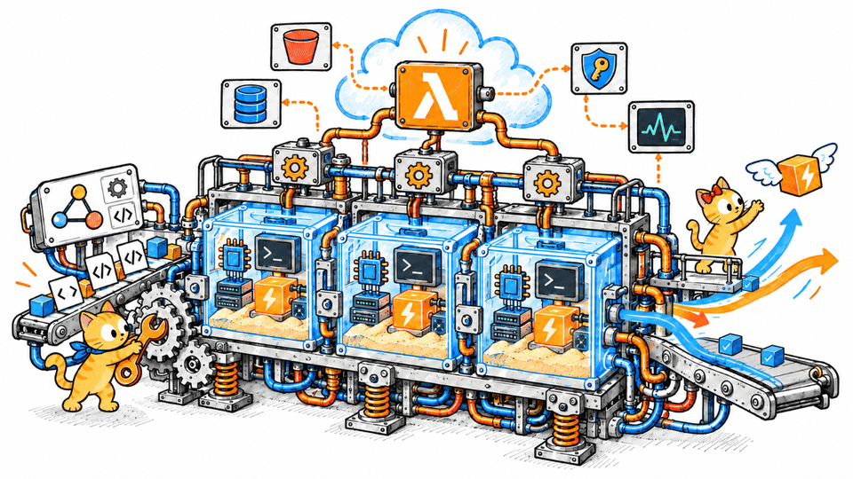
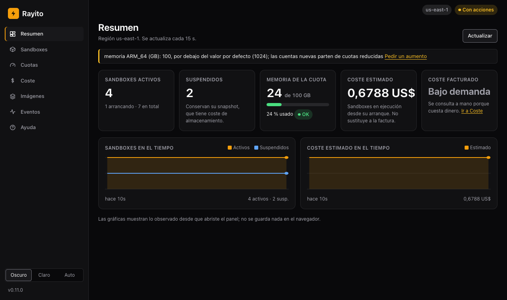

# Rayito

**English** · [Español](README.es.md)

[](https://github.com/alejandro-cedeno-10/rayito/actions/workflows/ci.yml) [](https://pypi.org/project/rayito/) [](https://www.npmjs.com/package/rayito) [](LICENSE) [](https://scorecard.dev/viewer/?uri=github.com/alejandro-cedeno-10/rayito) [](https://alejandro-cedeno-10.github.io/rayito/en/)
<!-- OpenSSF Best Practices: after registering the project (https://www.bestpractices.dev/en/projects/new), add this badge at the end of the previous line with the project id:
[](https://www.bestpractices.dev/projects/<id>)
-->

Hardware-isolated execution sandboxes for AI agents, running in your own AWS
account on Lambda MicroVMs.

> Sandboxes that appear in a flash. Inside your own AWS account.

E2B's ergonomics without your customers' code leaving your account, and
without a cluster to operate: the SDK talks directly to the Lambda MicroVMs
API.

**[Get started](https://alejandro-cedeno-10.github.io/rayito/en/primeros-pasos/)** ·
[Documentation](https://alejandro-cedeno-10.github.io/rayito/en/) ·
[Install](#install) ·
[Migrate from E2B](https://alejandro-cedeno-10.github.io/rayito/en/migrar-desde-e2b/) ·
[Agent in the sandbox](https://alejandro-cedeno-10.github.io/rayito/en/guias/agente-en-el-sandbox/)

About 15 minutes to set up your account. If Rayito is useful to you, a star on
GitHub helps other people find it.

<p align="center">
  
</p>

## Deploy your agent in one command

Already have an agent (LangGraph, LangChain, Deep Agents, Strands, Hermes,
OpenCode, Vercel AI SDK or your own HTTP app)? Install the SDK and run
`rayito agent deploy ./my-agent` (Python: `deploy_agent`, TypeScript:
`deployAgent`). The SDK detects the framework, the entrypoint and the protocol,
and the model is reached through the secret gateway. You can tune memory,
concurrent sessions, queue, MicroVM pool, environment variables and egress.
Guide: [Deploy your agent](https://alejandro-cedeno-10.github.io/rayito/en/guias/despliega-tu-agente/) ·
[Agent fleets](https://alejandro-cedeno-10.github.io/rayito/en/guias/flota-de-agentes/).

## Install

```bash
pip install "rayito[cli]"   # Python SDK (Python >= 3.11) and the `rayito` CLI
pnpm add rayito             # TypeScript SDK (Node >= 20); or: npm i rayito / yarn add rayito / bun add rayito
```

The CLI (`rayito image publish`, `rayito doctor`…) is Python even if you use
the TypeScript SDK. Python extras: `cli`, `mcp` (MCP server), `otel`
(OpenTelemetry traces) and `custom-domain` (custom domain, experimental); the
optional TypeScript features load optional *peerDependencies*
([Installation](https://alejandro-cedeno-10.github.io/rayito/en/primeros-pasos/instalacion/#extras-opcionales)).

## First sandbox

With the `rayito-base` image published in your account
([Get started in your AWS account](#get-started-in-your-aws-account)) and
`AWS_PROFILE`, `AWS_REGION` and `RAYITO_TEMPLATE=rayito-base` exported:

```python
from rayito import Sandbox

with Sandbox.create() as sbx:  # `with` kills the sandbox on exit
    print(sbx.commands.run("echo hello").stdout)  # "hello\n"
    sbx.files.write("/home/user/data.csv", "a,b\n1,2\n")
    print(sbx.run_code("import pandas as pd; pd.read_csv('/home/user/data.csv').shape").text)  # "(1, 2)"
```

```ts
import { Sandbox } from "rayito";

await using sbx = await Sandbox.create(); // `await using` kills the sandbox on exit
console.log((await sbx.commands.run("echo hello")).stdout); // "hello\n"
console.log((await sbx.runCode("x = 40; x + 2")).text); // "42"
```

If you come from the E2B SDK, `rayito.e2b` (Python) and `rayito/e2b`
(TypeScript) are an import-level drop-in for E2B 2.x: what Lambda MicroVMs
cannot do raises `UnimplementedError` instead of approximating silently
([Differences from E2B](https://alejandro-cedeno-10.github.io/rayito/en/e2b-compat/)). The shim requires a 0.3.0 or later
image.

```python
from rayito.e2b import Sandbox  # before: from e2b_code_interpreter import Sandbox

with Sandbox.create(timeout=300, metadata={"run": "42"}) as sbx:
    print(sbx.run_code("1 + 1").text)  # "2"
    sbx.set_timeout(600)  # rayd moves the deadline, up to max_lifetime
```

## A coding agent inside the sandbox

`sbx.agent` runs a coding agent ([OpenCode](https://github.com/anomalyco/opencode),
or deepagents) **inside** the sandbox. The agent calls its model (Bedrock,
Anthropic or an OpenAI-compatible endpoint) only through the
[secret gateway](https://alejandro-cedeno-10.github.io/rayito/en/funciones-opcionales/pasarela-de-secretos/): it uses the
credential but can never read it. A normal `Sandbox.create()` on the
`rayito-agent` image is enough (`rayito agent template build`,
[Agent templates](https://alejandro-cedeno-10.github.io/rayito/en/funciones-opcionales/templates-de-agente/)):

```python
from rayito import AgentModel, AgentSpec, Sandbox, SecretStore, bedrock_gateway

MODEL_ID = "us.anthropic.claude-haiku-4-5-20251001-v1:0"
SecretStore().create("bedrock-key", "Bearer <short-lived Bedrock key>")
spec = AgentSpec(model=AgentModel(provider="bedrock", id=MODEL_ID, gateway="bedrock", region="us-east-1"))

with Sandbox.create(
    template="rayito-agent",
    allow_internet_access=False,
    gateways={"bedrock": bedrock_gateway("bedrock-key", region="us-east-1", models=[MODEL_ID])},
) as sbx:
    result = sbx.agent.run("List the files in /home/user and summarize what is there.", spec=spec)
    print(result.text, result.usage.total)
```

The fast start (a pool with `warmup`) is optional; when it pays off, in
[Which one do I use?](https://alejandro-cedeno-10.github.io/rayito/en/guias/agente-en-el-sandbox/#que-uso). Full guide:
[Agent in the sandbox](https://alejandro-cedeno-10.github.io/rayito/en/guias/agente-en-el-sandbox/); what the VM costs
versus the model's tokens: [Pricing](https://alejandro-cedeno-10.github.io/rayito/en/cost/#coste-de-un-agente-vm-frente-a-modelo).

## What is included

Everything works the same in Python (sync and `asyncio`) and in TypeScript.

- **Lifecycle**: `create`, `connect`, `kill`, `list`, metadata
  ([Lifecycle](https://alejandro-cedeno-10.github.io/rayito/en/guias/ciclo-de-vida/)); `pause()`/`resume()` with
  idle auto-suspend ([Pause and resume](https://alejandro-cedeno-10.github.io/rayito/en/guias/pausar-reanudar/));
  a deadline that `rayd` enforces even if your process dies
  ([Server-side deadline](https://alejandro-cedeno-10.github.io/rayito/en/lifecycle/)).
- **Run**: `commands` ([Commands](https://alejandro-cedeno-10.github.io/rayito/en/guias/comandos/)), `run_code` with a
  stateful Jupyter kernel ([Run code](https://alejandro-cedeno-10.github.io/rayito/en/guias/ejecutar-codigo/)),
  bash, JavaScript and TypeScript kernels ([Languages and kernels](https://alejandro-cedeno-10.github.io/rayito/en/kernels/))
  and real terminals ([Terminal (PTY)](https://alejandro-cedeno-10.github.io/rayito/en/guias/terminal-pty/)).
- **Files and network**: `files`, large files and S3 presigned URLs
  ([Files and S3](https://alejandro-cedeno-10.github.io/rayito/en/files/)); E2B's outbound internet policy
  ([Outbound network](https://alejandro-cedeno-10.github.io/rayito/en/network/)); HTTP to a sandbox port
  ([Ports and host](https://alejandro-cedeno-10.github.io/rayito/en/guias/puertos-y-host/)).
- **Start-up and lifetime**: sandboxes in under a second from a pool of
  suspended ones ([Pool](https://alejandro-cedeno-10.github.io/rayito/en/pool/)); `HOME` on S3 beyond the 8 h
  ([Persistence](https://alejandro-cedeno-10.github.io/rayito/en/persistence/)).
- **Observe**: metrics and history, resumable listing
  ([Metrics and listing](https://alejandro-cedeno-10.github.io/rayito/en/observability/)); E2B's git API ([Git](https://alejandro-cedeno-10.github.io/rayito/en/git/)).
- **Agents**: the agent inside the sandbox (above); the MCP server for
  Claude Code, Cursor or VS Code ([MCP server](https://alejandro-cedeno-10.github.io/rayito/en/mcp/)); adapters for
  LangChain and Vercel AI ([LangChain and Vercel AI](https://alejandro-cedeno-10.github.io/rayito/en/guias/langchain-y-vercel-ai/)).
- **`rayito` CLI**: publish images, `doctor`, operate sandboxes, optional
  stacks ([CLI](https://alejandro-cedeno-10.github.io/rayito/en/cli/)).
- **Management dashboard**: `rayito dashboard` opens a local web dashboard
  with your sandboxes, quotas, cost and images; actions only with
  `--allow-actions` ([step-by-step tour](https://alejandro-cedeno-10.github.io/rayito/en/funciones-opcionales/panel-de-gestion/#recorrido)).

  
- **Test locally** with Docker and Floci, without an AWS account
  ([Test locally](https://alejandro-cedeno-10.github.io/rayito/en/guias/probar-en-local/)).
- **Optional features, off by default** (each one costs something in your
  account and is only enabled with an explicit option): Secrets Manager
  secrets, secret gateway, S3 mounts, sizes from 512 MiB to 8 GiB, events and
  webhooks, OTLP export, OpenTelemetry traces, metadata index in DynamoDB,
  declarative and agent templates, local proxy, EFS volumes (experimental) and
  custom domain (experimental). What each one enables and costs:
  [Optional features](https://alejandro-cedeno-10.github.io/rayito/en/optional-features/).

## How it works

```
your process (Python / TypeScript)              AWS, your account
┌───────────────────────────────┐   HTTPS/2    ┌──────────────────────────────┐
│ rayito SDK                    │ ───────────► │ Lambda MicroVMs proxy        │
│  · boto3 / JS SDK: run-microvm│              │   ▼ h2c                      │
│  · gRPC: commands, files,     │              │ MicroVM: rayd → sidecar →    │
│    run_code, pty              │ ◄─────────── │   ipykernel (your code here) │
└───────────────────────────────┘   streams    └──────────────────────────────┘
```

- **The SDK never runs inside the sandbox.** It lives in your process (your
  app, your agent, your CI) and only sends RPCs: it creates the MicroVM with
  your account's `lambda-microvms` API and talks gRPC to `rayd`, the Rust
  agent that lives inside the image. Nothing of your agent's runtime is
  copied into the VM.
- **Where your code runs.** What you send with `run_code` runs in a Jupyter
  kernel inside the MicroVM as uid 1000 (with state between cells);
  `commands`, `pty` and `sbx.agent` launch normal processes right there,
  also as uid 1000. `rayd` runs as root and is the only one that touches the
  Lambda hooks. The bash, JavaScript and TypeScript (Deno) kernels live in
  the `rayito-base-poly` image variant
  ([Languages and kernels](https://alejandro-cedeno-10.github.io/rayito/en/kernels/)).
- **From which languages.** Today, Python and TypeScript. Any other language
  with a gRPC client can talk to `rayd` by generating the client from
  `proto/rayito/v1/` ([Other languages (gRPC)](https://alejandro-cedeno-10.github.io/rayito/en/referencia/otros-lenguajes/)).

Details on processes, users, tokens and transports in
[Concepts](https://alejandro-cedeno-10.github.io/rayito/en/concepts/) and in `ARCHITECTURE.md` ("What runs where", in
Spanish).

## Get started in your AWS account

Four steps, all in your own account (Rayito has no server or API key). The
full recipe, with every command, is in
[Set up AWS](https://alejandro-cedeno-10.github.io/rayito/en/primeros-pasos/configurar-aws/).

1. **IAM**: deploy the build and execution roles and the client policies
   ([`infra/README.md`](infra/README.md)):

   ```bash
   aws cloudformation deploy --stack-name rayito-m0-iam \
     --template-file infra/iam.yaml --capabilities CAPABILITY_NAMED_IAM \
     --parameter-overrides ArtifactBucket=amzn-s3-demo-bucket LogGroupPrefix=/rayito
   ```

   Attach the `CallerPolicyArn` output policy to your user
   (`rayito-m0-caller-<region>`) and, to your service's role, only the
   `SandboxLauncherPolicyArn` one ([IAM](https://alejandro-cedeno-10.github.io/rayito/en/operacion/iam/)).

2. **Image**: publish `rayito-base` from the release's signed
   `rayito-image.zip`, without building anything. Verify the signature
   before publishing ([Verify a release](https://alejandro-cedeno-10.github.io/rayito/en/verify/)):

   ```bash
   RAYD_VERSION=$(python -c "import rayito; print(rayito.__version__)")   # the installed SDK's
   curl -fsSLO "https://github.com/alejandro-cedeno-10/rayito/releases/download/rayd-v${RAYD_VERSION}/rayito-image.zip"
   curl -fsSLO "https://github.com/alejandro-cedeno-10/rayito/releases/download/rayd-v${RAYD_VERSION}/rayito-image.zip.sigstore.json"
   cosign verify-blob --bundle rayito-image.zip.sigstore.json \
     --certificate-identity "https://github.com/alejandro-cedeno-10/rayito/.github/workflows/release.yml@refs/tags/rayd-v${RAYD_VERSION}" \
     --certificate-oidc-issuer https://token.actions.githubusercontent.com rayito-image.zip
   rayito image publish --artifact rayito-image.zip --base-image-version 1 --bucket amzn-s3-demo-bucket
   ```

   The image must carry the same-version `rayd` as the SDK
   (`rayito doctor` checks it). The `-caps` (outbound network and the
   agent) and `-poly` (bash, JavaScript and TypeScript kernels) variants, in
   [Images](https://alejandro-cedeno-10.github.io/rayito/en/images/). From source: `make image-publish
   BUCKET=amzn-s3-demo-bucket`, which builds `rayd` for
   `aarch64-unknown-linux-musl` on Linux or WSL2 (on macOS, inside a Linux
   VM) with `cargo-zigbuild` ([`CONTRIBUTING.md`](CONTRIBUTING.md)).

3. **Diagnosis**: `rayito doctor --template rayito-base` checks
   credentials, quotas, IAM, bucket, image, agent version and SDK ↔ `rayd`
   compatibility; `--launch` also tries an ephemeral sandbox.

4. **First sandbox**: [First sandbox](https://alejandro-cedeno-10.github.io/rayito/en/quickstart/).

## Cost and latency

A sandbox bills Lambda MicroVMs compute while it runs, plus the storage of
each image version and of suspended sandboxes; there are no Rayito charges.
List prices, examples, measured timings and the cost of an agent (VM versus
model tokens), in [Pricing](https://alejandro-cedeno-10.github.io/rayito/en/cost/). The cold-start measurements are in
[`docs/benchmarks/2026-09-cold-start.md`](docs/benchmarks/2026-09-cold-start.md).

## Status

**Alpha, 0.14 series** ([License, status and support](#license-status-and-support)).
The Python and TypeScript SDKs and `rayd` advance in `MAJOR.MINOR` lockstep:
each SDK requires an image built with the `rayd` of its own series, and
`rayito doctor` checks it (table in
[SDK ↔ rayd ↔ image compatibility](https://alejandro-cedeno-10.github.io/rayito/en/limits/#compatibilidad-sdk-rayd-imagen)).
What each version brings: [What's new](https://alejandro-cedeno-10.github.io/rayito/en/novedades/) and each component's
`CHANGELOG.md`.

## Documents

Most repository documents are written in Spanish.

| File | Contents |
|---|---|
| `SPEC.md` | What we build, scope, non-goals, decisions |
| `ARCHITECTURE.md` | The three layers and the ADRs |
| `AWS_API_NOTES.md` | Verified AWS API surface. **Read before touching `src/`** |
| `docs/aws-api/` | Raw appendix: `service-2.json` model, `help` of the 25 commands, shapes summary |
| `MILESTONES.md` | Milestones and acceptance criteria |
| `infra/` | CloudFormation templates: build, execution and client IAM (`iam.yaml`), egress connector, e2e OIDC role ([`infra/README.md`](infra/README.md)) |
| `CLAUDE.md` | Rules for working with Claude Code |
| `CONTRIBUTING.md` | How to contribute: requirements, setup (SDK and local Docker + Floci environment), GitHub Issues and OpenSpec, trunk-based branches, Conventional Commits, DCO and signed commits, PRs, gates and review |
| `SECURITY.md` | How to report a vulnerability, supported versions and the threat model |
| `SUPPORT.md` | Where to ask for help (documentation, `rayito doctor`, issues) |
| `CODE_OF_CONDUCT.md` | Contributor Covenant 3.0 |
| `GOVERNANCE.md` | Who decides and how (ADRs, OpenSpec changes, maintainers) |
| `LICENSE`, `NOTICE`, `CHANGELOG.md` | Apache-2.0, third-party attributions and the per-component changelogs |
| `docs/RELEASING.md` | Manual publishing steps (PyPI, npm, GitHub Release, tags) |
| `proto/rayito/v1/` | The gRPC contract. Source of truth for the whole API |

## Repository layout

```
proto/rayito/v1/         gRPC contract (package rayito.v1), source of truth
crates/rayd/             Rust agent (tonic) that runs inside the MicroVM
crates/rayd-core/        pure domain of the agent (no IO; ports as traits)
crates/rayito-proto/     Rust code generated from proto/
kernel-sidecar/          Python sidecar with jupyter_client (and Deno in -poly)
clients/python/          Python SDK (package `rayito`, shim `rayito.e2b`)
clients/typescript/      TypeScript SDK (package `rayito`, entry point `rayito/e2b`)
image/                   ARM64 Dockerfile of the images
infra/                   CloudFormation templates (IAM, egress, CI OIDC)
docs/site/               user documentation (mkdocs, Spanish and English)
docs/aws-api/            raw dump of the Lambda MicroVMs API
openspec/                specs and archived changes of each milestone
```

## License, status and support

- **Status**: alpha (`Development Status :: 3 - Alpha`). 0.x series with
  [SemVer](https://semver.org/): a MINOR may break compatibility and
  announces it in the changelog; a PATCH never does. Versioning, deprecation
  and support policy in
  [Versioning and support](docs/site/docs/limits.en.md#versionado-y-soporte).
- **License**: [Apache-2.0](LICENSE). Third-party attributions (vendored or
  adapted code) are in [`NOTICE`](NOTICE), which ships with the PyPI wheel
  and the npm package.
- **Contributing**: [`CONTRIBUTING.md`](CONTRIBUTING.md) (setup,
  gates, DCO and signed commits) and [`CODE_OF_CONDUCT.md`](CODE_OF_CONDUCT.md).
  Issues, pull requests and security reports in English or Spanish are
  welcome.
- **Help and security**: [`SUPPORT.md`](SUPPORT.md); vulnerabilities are
  reported privately according to [`SECURITY.md`](SECURITY.md).
- **Trademarks**: E2B is a trademark of its owner. Rayito is an independent
  project, **not affiliated with, sponsored or endorsed by E2B**; the name is
  used only to describe the API compatibility of `rayito.e2b` /
  `rayito/e2b`. AWS, Lambda and the other trademarks mentioned belong to
  their owners.

## Documentation languages

The documentation site is bilingual: Spanish (default) and English, with a
language switcher in the header. This README exists in both languages
([`README.es.md`](README.es.md) for Spanish). Code comments, docstrings and
user-facing SDK messages are in Spanish.
