# Panel de gestión: cuotas, coste y flota

Los servicios del SDK que alimentan el panel de gestión de MicroVMs
(ADR-026 en [`ARCHITECTURE.md`](https://github.com/alejandro-cedeno-10/rayito/blob/main/ARCHITECTURE.md)): `Quotas` (cuotas aplicadas de Lambda MicroVMs y
memoria asignada contra la cuota de la región), `UsageCost` (coste facturado
por Cost Explorer y coste estimado por sandbox) y `Fleet` (sandboxes,
imágenes, eventos y acciones masivas). Funcionan solos, sin ningún servidor:
lees tus propios datos con tus credenciales.

!!! note "Qué hay"
    La página cubre los **servicios del SDK** (Python síncrono y asíncrono, y
    TypeScript, con la misma superficie) y el **panel web local**
    (`rayito dashboard`, sólo CLI de Python), que se construye encima de
    ellos: [salta al panel](#panel-web-local). La pila opcional `dashboard`
    en tu cuenta (fase 2) tiene su propia página:
    [Panel en tu cuenta](panel-en-tu-cuenta.md).

!!! info "Coste y activación"
    - **Por defecto**: apagado. Construir `Quotas`, `UsageCost` o `Fleet` no
      llama a AWS, no crea ningún cliente ni importa ningún peer opcional.
      Sin llamar a un método no pasa nada, y un test en cada SDK lo
      comprueba.
    - **Activa**: una llamada explícita: `Quotas.report()`,
      `UsageCost.billed()` (la única que usa Cost Explorer; `estimate()` no),
      o cualquier método de `Fleet`. Las acciones masivas
      (`Fleet.run_bulk`/`runBulk`) exigen además `allow_actions=True`/
      `allowActions: true`: por defecto el servicio es de sólo lectura.
    - **Recursos y llamadas AWS**: sólo lecturas, ningún recurso nuevo.
      `ListServiceQuotas` (código `lambda`), `ListMicrovms`,
      `GetMicrovmImageVersion` (como mucho una por versión de imagen y
      proceso), `ListMicrovmImages` y `ListMicrovmImageVersions`; con
      `billed()`, `ce:GetCostAndUsage` en us-east-1; con acciones,
      `TerminateMicrovm`, `SuspendMicrovm` y `ResumeMicrovm` sobre los
      sandboxes que indiques. En TypeScript, los clientes de Service Quotas
      y Cost Explorer son peers opcionales que se importan en la primera
      llamada. Detalle: `AWS_API_NOTES.md` §30.
    - **Coste aproximado** (us-east-1, consultado 2026-10-13): $0 las
      lecturas de Lambda MicroVMs (`sandboxes`, `images`, `image_versions`),
      `estimate()` y `Quotas.report()`; Service Quotas no publica ninguna
      tarifa por consulta ([guía](https://docs.aws.amazon.com/servicequotas/latest/userguide/intro.html)),
      y `plan_bulk` es un cálculo local. **De pago**: `UsageCost.billed()`
      cobra **$0,01 por petición** a Cost Explorer
      ([precios](https://aws.amazon.com/aws-cost-management/aws-cost-explorer/pricing/)),
      una por ventana (una por página si hubiera más, y `DAILY` sobre
      ventanas largas pagina) en cada fallo de caché, y `refresh=True`
      siempre paga. La caché está en memoria, es de cada instancia (se pierde
      al terminar el proceso o al crear otra `UsageCost`), guarda como mucho
      64 ventanas y se indexa por inicio, fin, granularidad y región:
      reutiliza una sola instancia y un mes ronda las 30 peticiones, ≈
      $0,30; con una instancia nueva por llamada (cron, Lambda, script)
      cada `billed()` paga $0,01. `Fleet.events()` también es de pago,
      aunque mínimo: lecturas bajo demanda de DynamoDB sobre la tabla de
      `events-webhooks`, sin sondeo. Las acciones no se facturan por la
      llamada, pero cambian la factura (`AWS_API_NOTES.md` §12): `kill` deja
      de facturar cómputo; `suspend` escribe un snapshot ($0,0038/GB) y paga
      almacenamiento ($0,08/GB-mes) mientras esté suspendido; `resume` lee el
      snapshot ($0,00155/GB) y **vuelve a facturar cómputo** al precio de su
      tamaño ($0,1261/h con 2 GB y 1 vCPU), así que reanudar muchos sandboxes
      a la vez sube la factura.
    - **IAM**: `servicequotas:ListServiceQuotas`, `lambda:ListMicrovms`,
      `lambda:GetMicrovmImageVersion`, `lambda:ListMicrovmImages` y
      `lambda:ListMicrovmImageVersions` para leer; `ce:GetCostAndUsage` sólo
      para `billed()`; `lambda:TerminateMicrovm`, `lambda:SuspendMicrovm` y
      `lambda:ResumeMicrovm` sólo para las acciones. Ver
      [IAM mínimo](#iam-minimo).
    - **Cómo apagarla**: no llames a los métodos (no queda nada que borrar).
      Para quitar Cost Explorer basta con no llamar a `billed()`; para
      impedir las acciones, no pases `allow_actions=True` y no concedas los
      tres permisos de escritura.
    - **Ejemplo**:
      ```python
      from rayito import Quotas

      report = Quotas(region="us-east-1").report()
      print(report.memory.level)
      ```

## Cuándo usarlo

- Quieres saber cuánta memoria de tu cuota regional ocupan los sandboxes
  `RUNNING` y suspendidos, y que algo te avise antes de topar con el límite.
- Quieres ver el coste de MicroVMs de la cuenta por tipo de uso, o una
  estimación por sandbox, sin salir del código.
- Quieres verlo todo en el navegador, sin escribir código: arranca el
  [panel web local](#panel-web-local) con `rayito dashboard`.
- Operas una flota y necesitas listar sandboxes con la memoria de su imagen,
  imágenes y versiones, o suspender y matar en bloque respetando los TPS.
- **Cuándo no**: para facturar o repartir costes. El coste por sandbox es una
  estimación y nunca sustituye a la factura; para eso, Cost Explorer o el
  informe de costes y uso de tu cuenta.

## Cuotas y memoria asignada

`Quotas.report()` junta tres cosas: las cuotas aplicadas de la región
(Service Quotas), los sandboxes `RUNNING`, `SUSPENDING` y `SUSPENDED` de
`ListMicrovms` con la memoria mínima de su imagen, y los avisos.

=== "Python"

    ```python
    from rayito import Quotas

    report = Quotas(region="us-east-1").report()
    memory = report.memory
    print(memory.allocated_gb, memory.quota_gb, memory.level)  # (1)!
    for warning in report.warnings:
        print(warning.kind, warning.message, warning.increase_url)  # (2)!
    print(report.applied_rate("SuspendMicrovm"))  # (3)!
    ```

    1. `level` es `ok`, `warning` (desde el 80 % de la cuota) o `critical`
       (desde el 95 %); los umbrales son constantes de `limits.json`.
    2. Cada aviso trae el enlace de la consola de Service Quotas para pedir
       el aumento: pedirlo no es una acción del SDK.
    3. La tasa de TPS aplicada de una operación (2 para `SuspendMicrovm` por
       defecto), o `None` si Service Quotas no la lista.

=== "Python (async)"

    ```python
    import asyncio

    from rayito import AsyncQuotas


    async def main() -> None:
        report = await AsyncQuotas(region="us-east-1").report()
        print(report.memory.level, len(report.warnings))


    asyncio.run(main())
    ```

=== "TypeScript"

    ```ts
    import { Quotas } from "rayito";

    const report = await new Quotas({ region: "us-east-1" }).report();
    const { memory } = report;
    console.log(memory.allocatedGb, memory.quotaGb, memory.level);
    for (const warning of report.warnings) {
      console.log(warning.kind, warning.message, warning.increaseUrl);
    }
    console.log(report.appliedRate("SuspendMicrovm"));
    ```

| Campo | Qué es |
|---|---|
| `memory` | memoria asignada (GB) contra la cuota (`ARM_64`), la fracción, el nivel, los sandboxes contados y cuántos tienen la memoria de imagen sin resolver (`unresolved`: el uso real puede ser mayor) |
| `entries` | las 18 cuotas del catálogo con su valor aplicado (`None`/`undefined` si Service Quotas no la lista), el valor por defecto de la región y el enlace de aumento |
| `tps` | tasa y ráfaga aplicadas de cada operación |
| `warnings` | `memory_high`, `memory_critical`, `below_default` (las cuentas nuevas parten de cuotas reducidas) y `not_listed` |

!!! warning "Pendiente de medir en AWS real"
    Se está comprobando en una cuenta real si la cuota de memoria cuenta la
    memoria mínima de la imagen (lo que suma el SDK) o la que ve el guest, y
    si Service Quotas publica la utilización de estas cuotas. Hasta entonces
    el uso de memoria es el calculado por el SDK. Los TPS de `ListMicrovms` y
    `ListMicrovmImages` no están documentados por AWS. Detalle:
    `AWS_API_NOTES.md` §30.

## Coste facturado y coste estimado

Son dos cosas distintas y cada resultado lleva su rótulo.

| | `billed()` | `estimate()` |
|---|---|---|
| Rótulo | `billed` | `estimated` |
| De dónde sale | Cost Explorer, agrupado por tipo de uso (`Lambda-MicroVM-*`) | tiempo transcurrido desde el arranque de cada sandbox `RUNNING` por el precio de cómputo baseline |
| Retraso | unas 24 h; `partial` avisa de periodos aún estimados por AWS | ninguno |
| Cuesta | $0,01 por petición, con caché local de 24 h | $0 |
| Qué no incluye | otros servicios | snapshots (lectura, escritura, almacenamiento), consumo sobre el baseline, y el tiempo activo de los suspendidos |

=== "Python"

    ```python
    from rayito import UsageCost

    cost = UsageCost()
    billed = cost.billed()  # (1)!
    print(billed.total_usd, billed.partial, billed.requests)
    for line in billed.lines:
        print(line.component, line.quantity, line.unit, line.cost_usd)

    estimate = cost.estimate()  # (2)!
    print(estimate.label, estimate.total_usd)
    ```

    1. Por defecto, del día 1 del mes en curso (UTC) a mañana. Acepta
       `start`, `end` (`datetime.date` o `AAAA-MM-DD`), `granularity`
       (`MONTHLY` por defecto), `region` y `refresh=True` para saltarse la
       caché.
    2. La estimación nunca llama a Cost Explorer.

=== "Python (async)"

    ```python
    import asyncio

    from rayito import AsyncUsageCost


    async def main() -> None:
        cost = AsyncUsageCost()
        billed = await cost.billed(start="2026-10-01", end="2026-10-13")
        print(billed.total_usd, billed.label)
        print((await cost.estimate()).label)


    asyncio.run(main())
    ```

=== "TypeScript"

    ```ts
    import { UsageCost } from "rayito";

    const cost = new UsageCost();
    const billed = await cost.billed({ start: "2026-10-01", end: "2026-10-13" });
    console.log(billed.totalUsd, billed.partial, billed.requests);
    for (const line of billed.lines) {
      console.log(line.component, line.quantity, line.unit, line.costUsd);
    }
    const estimate = await cost.estimate();
    console.log(estimate.label, estimate.totalUsd);
    ```

`estimate().items` lleva un elemento por sandbox contado; los suspendidos
y los de memoria desconocida salen con `cost_usd`/`costUsd` vacío. En
TypeScript, `billed()` necesita el paquete opcional
`@aws-sdk/client-cost-explorer`, y `Quotas.report()`
`@aws-sdk/client-service-quotas`; sin ellos el error nombra el paquete a
instalar.

## Sandboxes, imágenes, eventos y acciones

`Fleet` es la vista de operación: el inventario con la memoria de cada
imagen, el catálogo de imágenes y sus versiones, el historial de eventos y
las acciones masivas.

=== "Python"

    ```python
    from rayito import Fleet, Quotas

    fleet = Fleet(region="us-east-1", allow_actions=True)  # (1)!
    running = fleet.sandboxes(states={"RUNNING"})
    print([(view.sandbox_id, view.memory_mib) for view in running])

    rate = Quotas(region="us-east-1").report().applied_rate("SuspendMicrovm")
    plan = fleet.plan_bulk("suspend", len(running), applied_rate=rate)  # (2)!
    print(plan.tps, plan.estimated_seconds)

    result = fleet.run_bulk(
        "suspend",
        [view.sandbox_id for view in running],
        applied_rate=rate,
        on_progress=lambda progress: print(progress.done, progress.total),
    )
    print(result.count("done"), result.count("failed"))
    ```

    1. Sin `allow_actions=True`, `run_bulk` lanza `InvalidArgumentException`
       antes de llamar a nadie.
    2. La cola va a la menor de las dos tasas: la de `apiTps`
       (`SuspendMicrovm`: 2 TPS) y la cuota aplicada de tu cuenta.

=== "Python (async)"

    ```python
    import asyncio

    from rayito import AsyncFleet


    async def main() -> None:
        fleet = AsyncFleet(region="us-east-1")
        images = await fleet.images()
        for image in images:
            versions = await fleet.image_versions(image.name)
            print(image.name, [version.image_version for version in versions])


    asyncio.run(main())
    ```

=== "TypeScript"

    ```ts
    import { Fleet, Quotas } from "rayito";

    const fleet = new Fleet({ region: "us-east-1", allowActions: true });
    const running = await fleet.sandboxes({ states: ["RUNNING"] });
    console.log(running.map((view) => [view.sandboxId, view.memoryMib]));

    const rate = (await new Quotas({ region: "us-east-1" }).report()).appliedRate("SuspendMicrovm");
    const result = await fleet.runBulk(
      "suspend",
      running.map((view) => view.sandboxId),
      {
        appliedRate: rate,
        onProgress: (progress) => console.log(progress.done, progress.total),
      },
    );
    console.log(result.count("done"), result.count("failed"));
    ```

- **Inventario**: `ListMicrovms` sólo trae el id, el estado, la imagen, la
  versión y `startedAt` (sin etiquetas ni filtros por metadatos). La vista
  añade la memoria mínima de la imagen. Nunca lleva `envs`, el
  `runHookPayload`, tokens ni el endpoint.
- **Imágenes**: `images()` y `image_versions()`/`imageVersions()` (la
  versión más nueva primero). De cada artefacto sólo se conserva el nombre
  del fichero, nunca el bucket ni la ruta.
- **Eventos**: `events()` lee el historial de la pila
  [`events-webhooks`](eventos-y-webhooks.md) si se pasa
  `events=LifecycleEvents(...)`; sin ella lanza
  `InvalidArgumentException`, porque el SDK no despliega nada por su cuenta.
- **Acciones masivas**: matar (`kill`), suspender (`suspend`) y reanudar
  (`resume`), de uno en uno y al ritmo de la cuota de TPS de su operación.
  Un fallo de un sandbox no detiene a los demás: queda `failed` con el
  **código** de AWS (nunca su mensaje): `ServiceQuotaExceededException` o
  `InsufficientCapacityException` si la cuenta se queda sin cuota o sin
  capacidad, y `UnknownError` si el error no trae código. Una cuota
  aplicada no positiva en `applied_rate` es `InvalidArgumentException`. Una acción sobre un sandbox que ya
  no necesita nada (por ejemplo, suspender uno que no está `RUNNING`) queda
  `unchanged`. Un id repetido se aplica una sola vez.

## Panel web local: `rayito dashboard` { #panel-web-local }

`rayito dashboard` arranca en tu máquina un servidor en `127.0.0.1` que
sirve una página (módulos ES y web components, sin Node ni compilación,
empaquetada en el wheel) y la [API JSON `/api/v1`](../referencia/api-del-panel.md)
sobre los mismos servicios `Quotas`, `UsageCost` y `Fleet`. Usa tus
credenciales de AWS y no deja nada desplegado: al pulsar Ctrl+C se acaba.

!!! info "Coste y activación del panel local"
    - **Por defecto**: apagado, y de **sólo lectura**. Hasta que no ejecutas
      `rayito dashboard` no hay ningún proceso, llamada ni cliente de AWS.
      Arrancarlo tampoco llama a AWS: cada vista llama cuando la abres.
    - **Activa**: `rayito dashboard`. Con `--allow-actions`, matar, suspender
      y reanudar (con confirmación). Con `--cost-explorer`, la consulta del
      coste facturado (un botón; nunca se lanza sola). Con
      `--events-stack <nombre>`, la vista de eventos.
    - **Recursos y llamadas AWS**: sólo lecturas y ningún recurso nuevo:
      `ListMicrovms`, `GetMicrovmImageVersion`, `ListMicrovmImages`,
      `ListMicrovmImageVersions`, `ListServiceQuotas` y, al pedir los logs
      de un sandbox, `GetMicrovm`, `DescribeLogStreams` y `GetLogEvents`. Una caché de
      segundos evita que varias pestañas multipliquen las llamadas.
    - **Coste aproximado**: $0 las lecturas de sandboxes, imágenes, cuotas y
      logs (`DescribeLogStreams` y `GetLogEvents` no tienen tarifa propia
      publicada en [CloudWatch](https://aws.amazon.com/cloudwatch/pricing/);
      sólo cobran la ingesta, el almacenamiento y Logs Insights, y el panel
      no lanza consultas de Logs Insights). **De pago**, y sólo si lo
      activas: con `--cost-explorer`, Cost Explorer cobra **$0,01 por
      consulta** ([precios](https://aws.amazon.com/aws-cost-management/aws-cost-explorer/pricing/),
      us-east-1, consultado 2026-10-13), también con «Ignorar la caché»;
      cada ventana se guarda 24 h en memoria (se pierde al cerrar el panel).
      Con `--events-stack`, la vista de eventos lee la tabla DynamoDB de la
      pila (lecturas bajo demanda, unas pocas por vista y sin sondeo). Con
      `--allow-actions`, las acciones no facturan por la llamada pero
      cambian la factura (`AWS_API_NOTES.md` §12): matar deja de facturar
      cómputo; suspender escribe un snapshot ($0,0038/GB) y paga almacenamiento ($0,08/GB-mes); reanudar lee el snapshot ($0,00155/GB) y **vuelve a facturar cómputo**. El arranque lo anuncia en la
      primera línea cuando `--cost-explorer` está activo.
    - **IAM**: los de [IAM mínimo](#iam-minimo); `lambda:GetMicrovm`, `logs:DescribeLogStreams`
      y `logs:GetLogEvents` para los logs.
    - **Cómo apagarlo**: Ctrl+C. No queda nada que borrar.
    - **Ejemplo**:
      ```bash
      AWS_REGION=us-east-1 rayito dashboard
      ```

### Arrancarlo

```bash
AWS_REGION=us-east-1 rayito dashboard
# Panel de Rayito (us-east-1, sólo lectura). Ábrelo en tu navegador:
# http://127.0.0.1:<puerto>/?token=<se muestra una sola vez>
```

La URL lleva un token **de un solo uso**: ábrela en tu navegador (o usa
`--open`) y el servidor lo cambia por una cookie de sesión. Si la pierdes o
la gastas, cierra el panel y vuelve a arrancarlo. El puerto es uno libre al
azar salvo que pases `--port`.

| Opción | Qué hace |
|---|---|
| `--port N` | Puerto local (por defecto uno libre al azar). Sólo escucha en `127.0.0.1`. |
| `--allow-actions` | Habilita matar, suspender y reanudar. Sin ella, el servidor rechaza cualquier acción y no llama a AWS. Reanudar vuelve a facturar cómputo. |
| `--cost-explorer` | **De pago**: permite consultar el coste facturado (cada consulta cuesta $0,01, también «Ignorar la caché»). |
| `--events-stack NOMBRE` | Nombre de la pila `events-webhooks` desplegada: activa la vista de eventos (lecturas de DynamoDB, de pago aunque mínimo). |
| `--log-group GRUPO` | Grupo de CloudWatch de los logs (por defecto, el de cada imagen); sin tarifa propia para leerlos. |
| `--theme FICHERO` | Tema propio (`.json` o `.css`), también por `RAYITO_DASHBOARD_THEME`. Ver [Personalizar el tema](#personalizar-el-tema). |
| `--logo FICHERO` | Logo propio (PNG o SVG de hasta {{dashboardLogoMaxBytes}} bytes), también por `RAYITO_DASHBOARD_LOGO`. |
| `--open` | Abre la URL de arranque en el navegador. |

### Recorrido paso a paso { #recorrido }

Un recorrido del panel local, con las capturas de cada paso. Todas las imágenes
salen del propio panel sobre datos de ejemplo (sandboxes, importes y logs
inventados, con identificadores de relleno): sin cuentas, URL, tokens ni
nombres reales, y sin metadatos. Tus valores serán distintos.

**1. Instala la CLI.** El panel es parte de la CLI de Python (extra `cli`);
el panel local es una orden de la CLI de Python y no tiene equivalente en TypeScript.

```bash
pip install "rayito[cli]"        # o: uv pip install "rayito[cli]"
rayito dashboard --help
```

**2. Arranca el panel.** Con `--allow-actions` para poder actuar y, si tienes
la pila de [eventos](eventos-y-webhooks.md), con `--events-stack`:

```bash
AWS_REGION=us-east-1 rayito dashboard --allow-actions --events-stack mi-pila-de-eventos
```

Abre la URL que imprime (de un solo uso). Arriba a la derecha ves la región y
el modo: **Con acciones** o **Sólo lectura**.

**3. Mira el Resumen.** Sandboxes activos y suspendidos, la memoria contra la
cuota de la región, el coste estimado y, por separado y apagado por defecto, el
facturado.

{ loading=lazy }

**4. Abre Sandboxes.** Una fila por MicroVM, con su estado, memoria y
antigüedad. Filtra por estado o busca por ID o imagen.

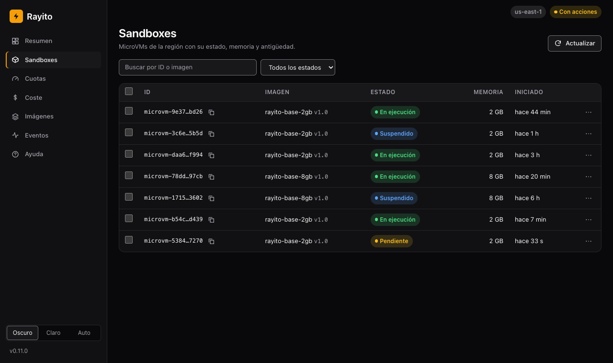{ loading=lazy }

**5. Abre el menú de una fila (⋯).** Copia el ID, abre los logs o lanza una
acción. Sin `--allow-actions` el menú sólo ofrece «Copiar ID» y «Ver logs».

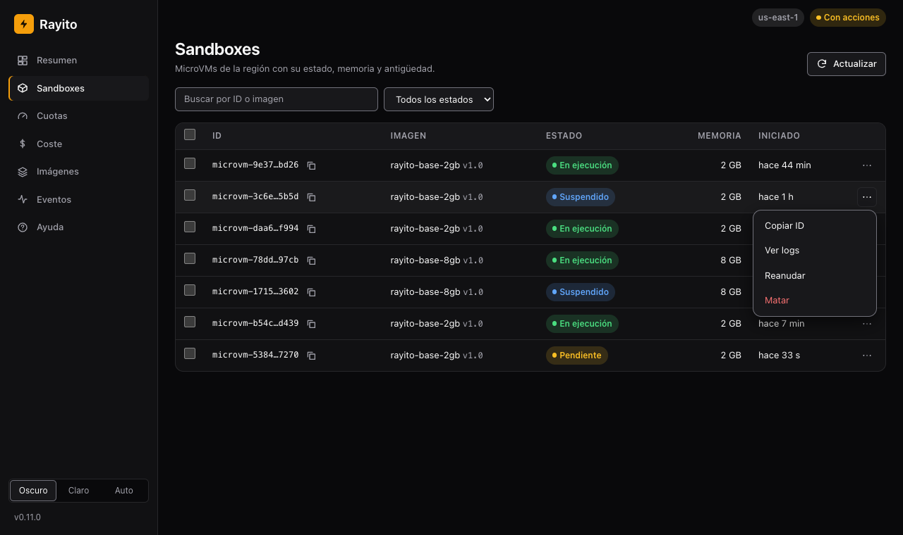{ loading=lazy }

**6. Lee los logs de un sandbox.** «Ver logs» abre las líneas del
grupo de CloudWatch del sandbox; leerlas no tiene tarifa propia.

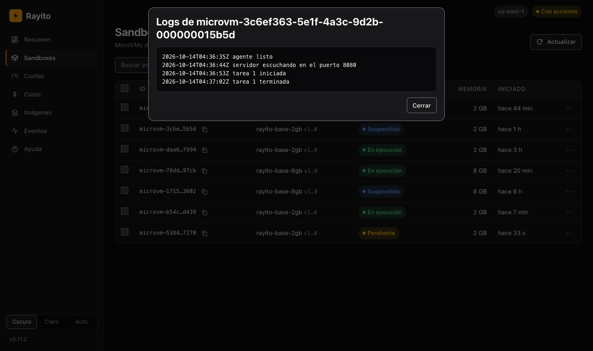{ loading=lazy }

**7. Confirma la acción.** El panel dice qué vas a hacer, a cuántos
sandboxes y cuánto tardará la cola. Reanudar vuelve a facturar cómputo.

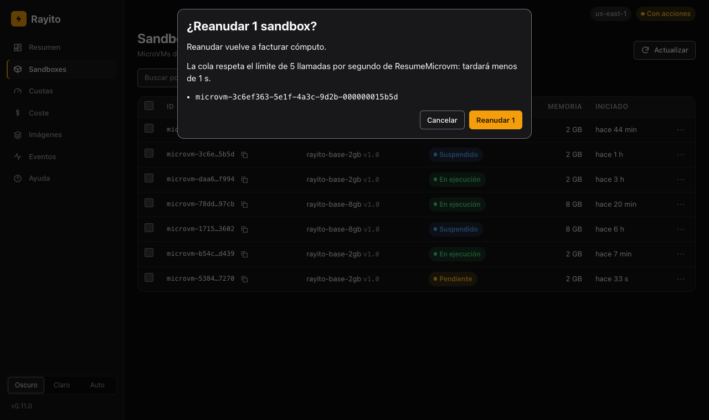{ loading=lazy }

**8. Comprueba el resultado.** La barra de progreso resume cuántos se
hicieron, cuántos no cambiaron y cuántos fallaron; la tabla se actualiza.

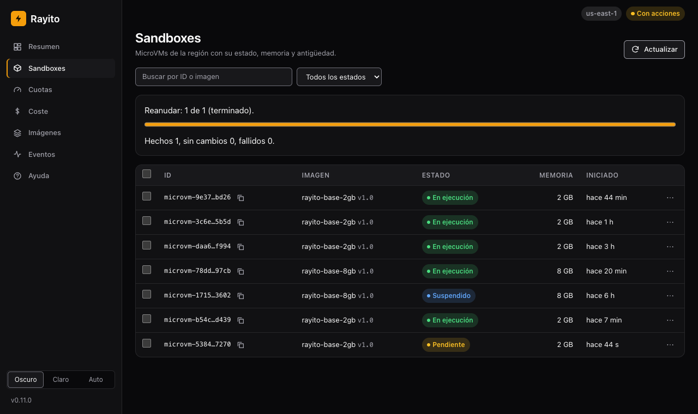{ loading=lazy }

**9. Revisa las Cuotas.** La memoria asignada contra la cuota, los límites
de tasa por operación y las cuotas de capacidad, con el enlace para pedir un
aumento.

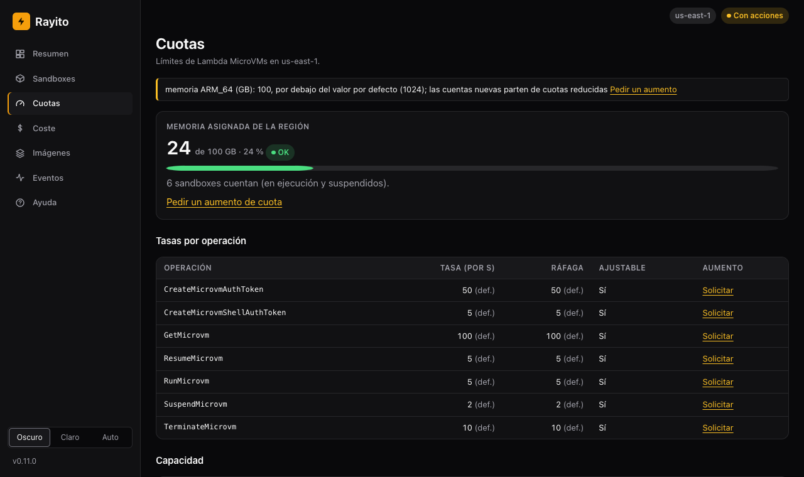{ loading=lazy }

**10. Consulta el Coste, estimado y facturado.** *Estimado* lo calcula el
panel y es gratis. *Facturado* viene de Cost Explorer y es **de pago**: sólo
existe con `--cost-explorer` y pulsando el botón (cada consulta cuesta
$0,01, también «Ignorar la caché»).

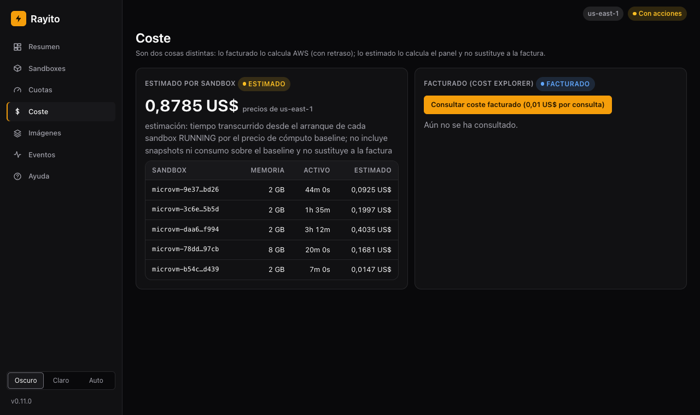{ loading=lazy }

Con `--cost-explorer` y tras pulsar el botón, el panel muestra el facturado por
tipo de uso junto al estimado. Cost Explorer tiene unas 24 h de retraso y el
estimado nunca sustituye a la factura. Los importes de la captura son de
ejemplo.

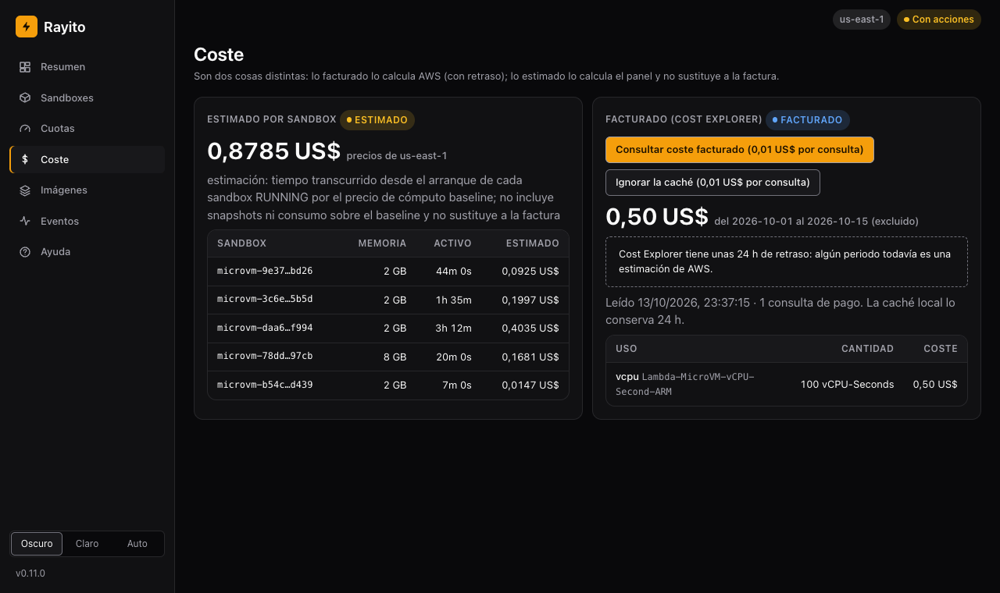{ loading=lazy }

!!! info "Coste y activación del coste facturado"
    - **Activa**: `rayito dashboard --cost-explorer` y pulsar «Consultar coste
      facturado». Nada lo lanza solo.
    - **Coste aproximado**: $0,01 por consulta a Cost Explorer
      ([precios](https://aws.amazon.com/aws-cost-management/aws-cost-explorer/pricing/),
      us-east-1, consultado 2026-10-13); cada ventana se guarda 24 h en memoria.
    - **Cómo apagarlo**: arranca el panel sin `--cost-explorer`.

**11. Mira las Imágenes.** Las imágenes de la cuenta, su estado y su última
versión activa.

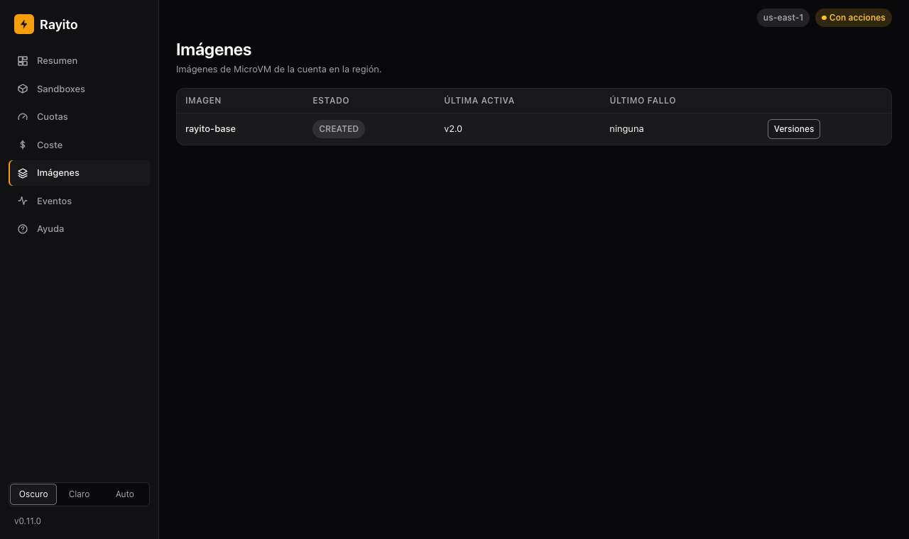{ loading=lazy }

**12. Lee los Eventos.** El historial de ciclo de vida (creado, pausado,
reanudado, matado) de la pila `events-webhooks`.

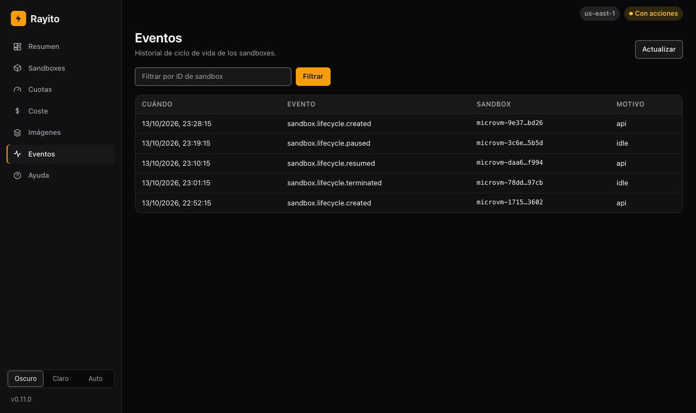{ loading=lazy }

**13. Cambia de tema.** El selector de la esquina inferior alterna entre
oscuro, claro y automático.

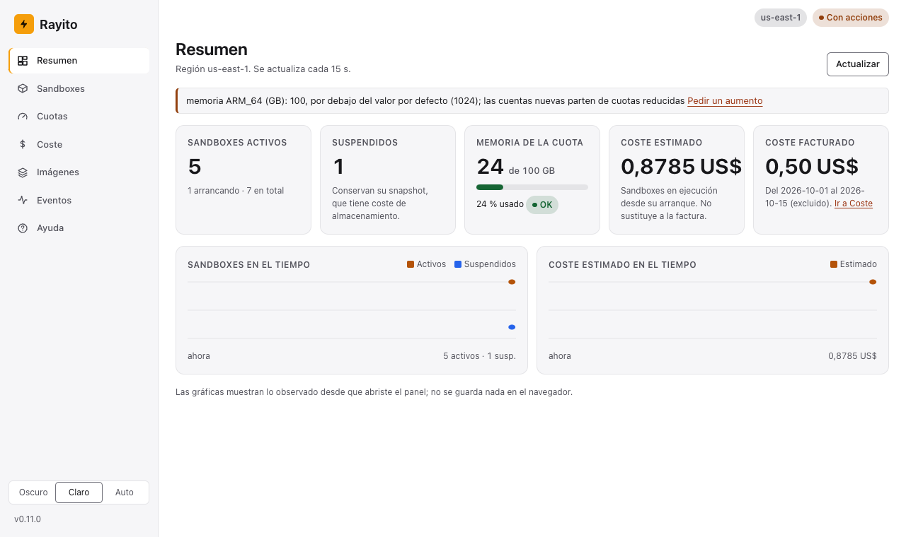{ loading=lazy }

**14. Pon tu propia paleta y logo.** Con `--theme` y `--logo`
([Personalizar el tema](#personalizar-el-tema)). La captura usa el ejemplo
inventado `examples/dashboard-theme/` del repositorio:

```bash
rayito dashboard --theme examples/dashboard-theme/aurora.json \
                 --logo examples/dashboard-theme/aurora-logo.svg
```

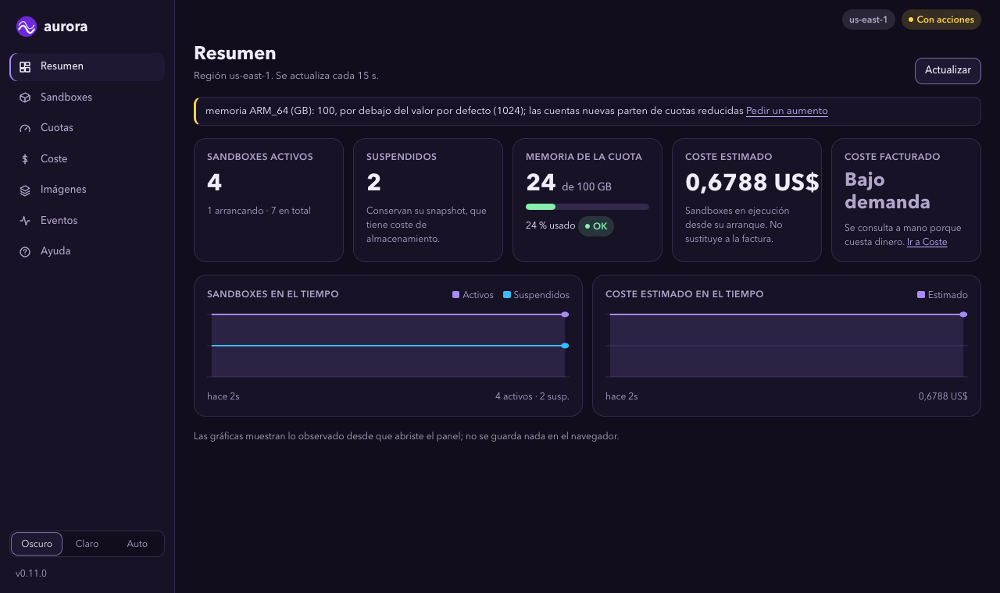{ loading=lazy }

**15. Abre la Ayuda.** La entrada **Ayuda** de la barra lateral resume estos
pasos, dice qué opciones están activadas en esta sesión y enlaza a esta guía.
Se pinta sin llamar a AWS ni a ningún sitio externo.

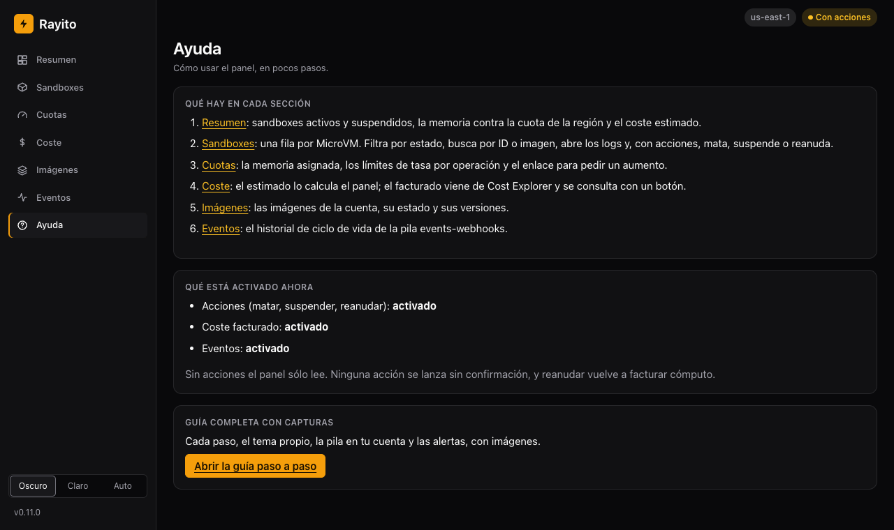{ loading=lazy }

### Qué muestra

- **Resumen** (la primera página): tarjetas con los sandboxes activos y
  suspendidos, la memoria usada contra la cuota de la región (con barra), el
  coste estimado y el facturado (bajo demanda), y dos gráficas, sandboxes y
  coste estimado en el tiempo. Las gráficas muestran lo observado desde que
  abriste el panel; no se guarda nada en el navegador.
- **Sandboxes**: tabla densa con cabecera fija, ID abreviado con botón de
  copiar, estado, memoria y tiempo desde el arranque, con filtro por estado y
  búsqueda por ID o imagen. El menú de cada fila (⋯) copia el ID, abre los
  logs (si la imagen tiene `executionRoleArn`) y lanza acciones; con
  `--allow-actions`, la barra de acciones masivas aparece sólo al seleccionar filas.
- **Cuotas**: una barra con la memoria asignada contra la cuota de la
  región (avisa al 80 % y es crítica al 95 %), los avisos de cuotas por
  debajo del valor por defecto y el enlace para pedir el aumento, y los
  límites de TPS por operación (tasa y ráfaga en una fila), separados de las
  cuotas de capacidad.
- **Coste**: dos tarjetas que **no se mezclan**. *Estimado* lo calcula el
  panel (tiempo activo por el precio documentado, sin snapshots ni consumo
  sobre el baseline) y nunca sustituye a la factura. *Facturado* viene de
  Cost Explorer, por tipo de uso, con unas 24 h de retraso (avisa si algún
  periodo sigue estimado por AWS) y sólo se consulta con `--cost-explorer` y
  pulsando el botón.
- **Imágenes**: las imágenes de la cuenta y sus versiones.
- **Eventos**: el historial de ciclo de vida de la pila `events-webhooks`
  (con `--events-stack`).

### Acciones

Con `--allow-actions`, selecciona sandboxes y pulsa **Matar**, **Suspender** o
**Reanudar**. Antes de nada, el panel muestra qué vas a hacer, a cuántos y
cuánto tardará, y pide confirmar. Las acciones entran en **una cola** que
respeta el límite de TPS de cada operación (por defecto, suspender 2/s,
reanudar 5/s y matar 10/s, o la cuota aplicada si es menor), con una barra
de progreso. Un fallo de un sandbox no detiene a los demás y sólo se muestra
su **código** de AWS, nunca su mensaje. No hay acción para "extender": AWS no
tiene `UpdateMicrovm`, y la duración máxima y la política de inactividad no
se pueden cambiar tras lanzar el sandbox
([AWS_API_NOTES.md](https://github.com/alejandro-cedeno-10/rayito/blob/main/AWS_API_NOTES.md)).

### Personalizar el tema { #personalizar-el-tema }

Todo color, radio, fuente y espacio del panel sale de **tokens de diseño**
(variables CSS). Trae dos temas de fábrica, `rayito-dark` (el de por defecto) y
`rayito-light`, y el selector del panel elige entre *Oscuro*, *Claro* y *Auto*
(sigue al sistema). Para usar tu propia paleta, pasa un fichero con los
valores de los tokens y, si quieres, un logo:

```bash
rayito dashboard --theme mi-tema.json --logo mi-logo.svg
# o con variables de entorno
RAYITO_DASHBOARD_THEME=mi-tema.json RAYITO_DASHBOARD_LOGO=mi-logo.svg rayito dashboard
```

El tema se **valida antes de abrir el puerto**; si algo no cumple, la orden
sale con código 2 y un mensaje que nombra la clave (nunca el valor ni la ruta).
Se sirve desde el mismo origen, con la misma CSP: no hay fuentes, imágenes ni
hojas remotas.

**Formato JSON** (`.json`). Todas las claves son opcionales salvo `version`:

```json
{
  "version": 1,
  "name": "aurora",
  "tokens": { "radius": "0.625rem", "font-sans": "\"Avenir Next\", system-ui, sans-serif" },
  "dark":  { "bg": "#110d1c", "primary": "#a78bfa", "on-primary": "#1a0b3b" },
  "light": { "bg": "#faf8fe", "primary": "#6d28d9", "on-primary": "#ffffff" }
}
```

- `tokens`: valores de cualquier token; valen para los dos esquemas (radios,
  espacios y fuentes van aquí). Un color puesto aquí vale para claro y oscuro.
- `dark` y `light`: sólo colores, para cada esquema; ganan sobre `tokens`.
- Lo que no pongas se queda como en el tema de fábrica.

**Formato CSS** (`.css`): sólo bloques `:root`, `:root[data-theme="dark"]` y
`:root[data-theme="light"]` con declaraciones `--token: valor;` (equivalen a
`tokens`, `dark` y `light`). No se admiten otros selectores, reglas `@` ni
`url()`.

**Qué se acepta.** Las claves son una lista cerrada y una clave desconocida se
rechaza. Cada valor debe cumplir la gramática de su tipo:

- *color*: `#rgb`, `#rgba`, `#rrggbb`, `#rrggbbaa`, o `rgb()`/`rgba()`/`hsl()`/`hsla()` con números;
- *longitud*: `0` o un número con `px`, `rem` o `em`;
- *fuente*: hasta 8 familias separadas por comas, con letras, números, espacios, `_` y `-` (`"Mi Fuente", system-ui`). Nombres instalados en el equipo: no se descargan fuentes.

El CSS que llega al navegador lo **genera el panel** desde los valores ya
validados; el texto del fichero nunca se copia tal cual, así que un tema no
puede inyectar CSS, scripts ni recursos remotos. Tamaño máximo del fichero:
{{dashboardThemeMaxBytes}} bytes.

| Token | Tipo | `rayito-dark` | `rayito-light` | Dónde se usa |
|---|---|---|---|---|
| `bg` | color | `#09090b` | `#ffffff` | Fondo de la página |
| `surface` | color | `#111113` | `#f6f6f8` | Barra lateral, tarjetas y tablas |
| `surface-raised` | color | `#18181b` | `#ffffff` | Controles, cabecera de tabla, menús y diálogos |
| `border` | color | `#27272a` | `#e4e4e7` | Separadores y bordes suaves |
| `border-strong` | color | `#71717a` | `#71717a` | Bordes de controles (contraste 3:1) |
| `fg` | color | `#fafafa` | `#18181b` | Texto |
| `fg-muted` | color | `#a1a1aa` | `#52525b` | Texto secundario |
| `primary` | color | `#f59e0b` | `#f59e0b` | Acento de marca: botón principal, logo por defecto, selección |
| `on-primary` | color | `#1c1100` | `#1c1100` | Texto sobre `primary` |
| `accent` | color | `#fbbf24` | `#9a3412` | Enlaces |
| `accent-strong` | color | `#fcd34d` | `#7c2d12` | Enlaces al pasar el ratón |
| `focus` | color | `#60a5fa` | `#1d4ed8` | Anillo de foco |
| `ok` | color | `#4ade80` | `#166534` | Estado correcto |
| `warning` | color | `#fbbf24` | `#92400e` | Aviso |
| `critical` | color | `#f87171` | `#b91c1c` | Crítico y acciones destructivas |
| `info` | color | `#60a5fa` | `#1d4ed8` | Información (suspendido, facturado) |
| `chart-1` | color | `#f59e0b` | `#b45309` | Serie 1 de las gráficas |
| `chart-2` | color | `#60a5fa` | `#2563eb` | Serie 2 |
| `chart-3` | color | `#a78bfa` | `#7c3aed` | Serie 3 |
| `radius` | longitud | `0.375rem` | igual | Radio de controles |
| `radius-lg` | longitud | `0.75rem` | igual | Radio de tarjetas y diálogos |
| `space-1` | longitud | `0.25rem` | igual | Espacio 1 |
| `space-2` | longitud | `0.5rem` | igual | Espacio 2 |
| `space-3` | longitud | `0.75rem` | igual | Espacio 3 |
| `space-4` | longitud | `1rem` | igual | Espacio 4 |
| `space-6` | longitud | `1.5rem` | igual | Espacio 6 |
| `sidebar-width` | longitud | `14rem` | igual | Ancho de la barra lateral |
| `font-sans` | fuente | del sistema | igual | Fuente del texto |
| `font-mono` | fuente | del sistema | igual | Fuente monoespaciada (IDs, código) |

Comprueba el contraste (AA: 4,5:1 para texto y 3:1 para bordes de controles y
foco) de tu paleta en los dos esquemas: el panel no lo corrige.

**Logo** (`--logo`): un PNG o un SVG de hasta {{dashboardLogoMaxBytes}} bytes, servido desde el propio
panel en `/theme/logo` y, además, con su propia CSP (`default-src 'none'`,
`sandbox`). Se valida por contenido, no por extensión. Un SVG con scripts,
`foreignObject`, animaciones, manejadores `on*`, DTD o entidades, o cualquier
`href` o `url()` que no sea un fragmento local (`#id`), se **rechaza**.

En el repositorio hay un ejemplo con una paleta inventada:
`examples/dashboard-theme/` (`aurora.json`, `aurora.css` y `aurora-logo.svg`).

!!! note "El mismo tema en la pila"
    El panel desplegado en tu cuenta ([Panel en tu cuenta](panel-en-tu-cuenta.md#tema))
    usa el mismo formato: el texto del tema (JSON) llega como parámetro de la pila
    (`ThemeJson`) o de SSM (`ThemeParameterName`) y pasa por las mismas
    funciones de validación (`parse_theme`, `parse_logo`) antes de servirse en
    `/theme.css` y `/theme/logo`. Las claves y el formato no cambian.

### Seguridad

El panel usa tus credenciales, así que se defiende de las webs que abras en
el mismo navegador: `Host` y `Origin` de loopback (si no, `421`/`403`),
token de arranque de un solo uso, cookie `HttpOnly` y `SameSite=Strict`,
token CSRF en todo `POST` y en la consulta de coste facturado, `Sec-Fetch-Site` y CSP sin `unsafe-inline` y nada registrado. Detalle
y riesgo residual en [Seguridad](../security.md#panel-de-gestion-local).

## IAM mínimo { #iam-minimo }

Concede sólo lo que uses.

```json
{
  "Version": "2012-10-17",
  "Statement": [
    {
      "Sid": "ReadFleet",
      "Effect": "Allow",
      "Action": [
        "servicequotas:ListServiceQuotas",
        "lambda:ListMicrovms",
        "lambda:ListMicrovmImages",
        "lambda:ListMicrovmImageVersions",
        "lambda:GetMicrovmImageVersion"
      ],
      "Resource": "*"
    },
    {
      "Sid": "ReadLogs",
      "Effect": "Allow",
      "Action": [
        "lambda:GetMicrovm",
        "logs:DescribeLogStreams",
        "logs:GetLogEvents"
      ],
      "Resource": "*"
    },
    {
      "Sid": "BilledCost",
      "Effect": "Allow",
      "Action": "ce:GetCostAndUsage",
      "Resource": "*"
    },
    {
      "Sid": "FleetActions",
      "Effect": "Allow",
      "Action": [
        "lambda:TerminateMicrovm",
        "lambda:SuspendMicrovm",
        "lambda:ResumeMicrovm"
      ],
      "Resource": "*"
    }
  ]
}
```

## Errores

Los errores se traducen por **código** de AWS y el mensaje sólo lo lleva a
él: el mensaje de AWS puede nombrar recursos de tu cuenta.

| Código de AWS | Excepción (Python / TypeScript) | Qué hacer |
|---|---|---|
| `AccessDeniedException` | `AuthenticationException` / `AuthenticationError` | falta el permiso de la sección anterior que corresponda a la llamada |
| `TooManyRequestsException`, `LimitExceededException`, `ThrottlingException` | `RateLimitException` / `RateLimitError` | reintenta más tarde; con Cost Explorer, usa la caché en vez de `refresh=True` |
| cualquier otro (por ejemplo `DataUnavailableException`, si Cost Explorer no está activado en la cuenta) | `DashboardException` / `DashboardError`, con `aws_code`/`awsCode` | depende del código |

## Ver también

- [Funciones opcionales y su coste](../optional-features.md)
- [Límites](../limits.md): cuotas y TPS de Lambda MicroVMs
- [Precios](../cost.md): de dónde salen los precios del cómputo
- [Panel en tu cuenta (la pila `dashboard`)](panel-en-tu-cuenta.md)
- [Eventos y webhooks](eventos-y-webhooks.md)
- [API JSON del panel](../referencia/api-del-panel.md)
- [`rayito dashboard` en la CLI](../cli.md#rayito-dashboard)
- [Referencia Python: opcionales](../referencia/python/opcionales.md#panel-de-gestion) y
  [Referencia TypeScript](../referencia/typescript.md#opcionales)
