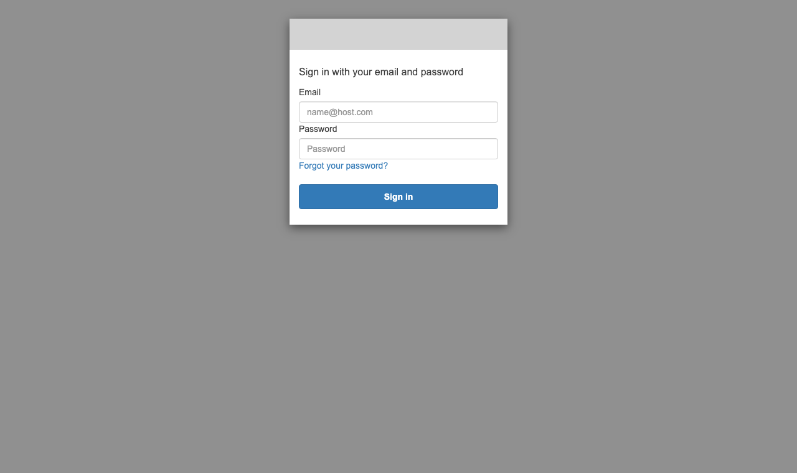
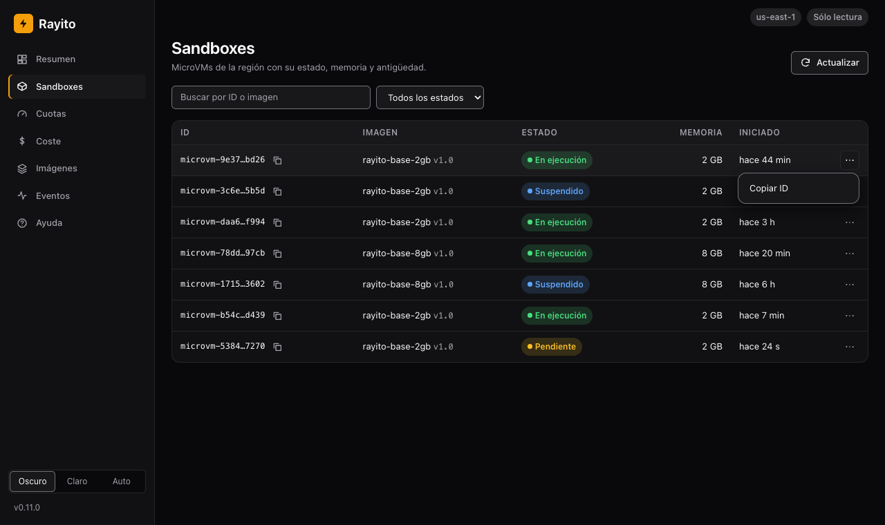
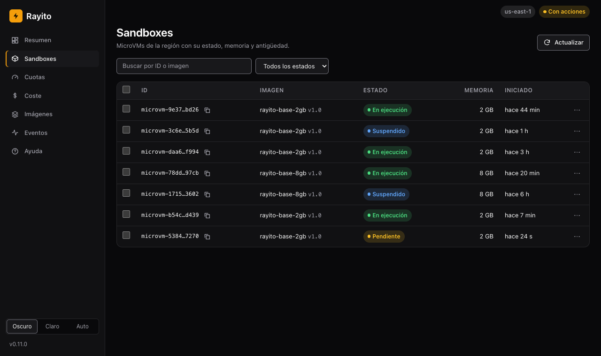
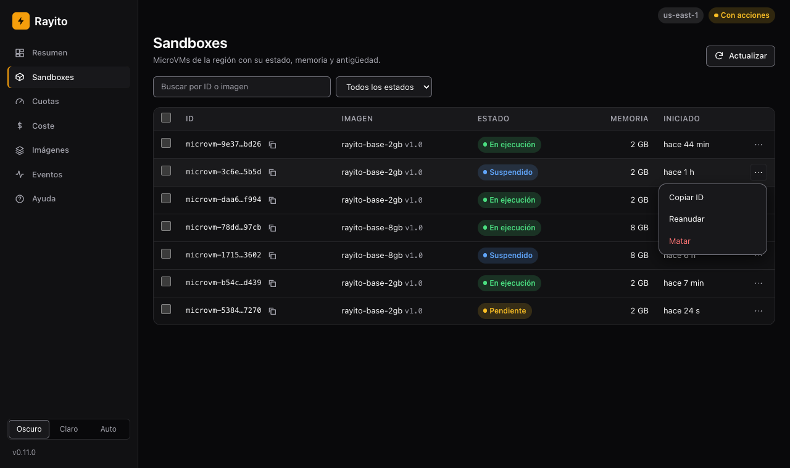

# Panel de gestión en tu cuenta: la pila `dashboard`

La misma página y la misma API `/api/v1` que
[`rayito dashboard`](panel-de-gestion.md#panel-web-local), pero desplegadas en
**tu cuenta de AWS** como una pila `OptionalStack` (ADR-026, fase 2): una
dirección HTTPS fija a la que entra tu equipo con un usuario y una contraseña,
sin tener nada abierto en ningún portátil. Rayito no opera ningún servidor: todo
lo que se crea es tuyo y `rayito stack destroy dashboard` lo borra.

!!! info "Coste y activación"
    - **Por defecto**: apagada. Nada se crea hasta que ejecutas
      `rayito stack deploy dashboard` (o `OptionalStacks().deploy("dashboard")`).
      Desplegada, es de **sólo lectura** y sin consultas de coste facturado.
    - **Activa**: `rayito stack deploy dashboard --artifact-bucket <bucket>`.
      `--param AllowActions=true` crea además el rol de acciones y
      `--param EnableCostExplorer=true` permite el coste facturado y
      `--param AuthMode=aws-iam` pone la API detrás de una Function URL que
      exige firma SigV4 ([variante `AWS_IAM`](#variante-aws-iam)).
    - **Recursos y llamadas AWS**: una función Lambda con su Function URL y su
      log group; un grupo de usuarios de Cognito con su cliente y su dominio del
      Hosted UI (y, con acciones, un grupo); dos tablas DynamoDB bajo demanda
      (auditoría y caché de coste); un rol de lectura y, con acciones, un rol de
      acciones; con `ThemeJson`, un parámetro de SSM. Con `AuthMode=aws-iam`,
      además, una segunda función con su URL (la página), un identity pool de
      Cognito, dos roles y un parámetro de SSM. **No crea** distribuciones de
      CloudFront ni buckets de S3.
    - **Coste aproximado**: ~$0 en reposo: sin tráfico no hay invocaciones, y
      Lambda, DynamoDB bajo demanda y Cognito sólo facturan por uso (los
      usuarios activos caben en la capa gratuita de Cognito). Por uso:
      - **Lambda**: una invocación por petición de la página, que sondea cada
        {{dashboardPollIntervalSeconds}} s con la pestaña abierta. Una pestaña
        abierta {{dashboardStackCostExampleOpenHoursPerDay}} h al día durante
        {{dashboardStackCostExampleDaysPerMonth}} días son unas 57600
        invocaciones al mes, dentro de las {{lambdaFreeTierRequestsPerMonth}}
        peticiones y los {{lambdaFreeTierGbSecondsPerMonth}} GB-s gratuitos al
        mes; pasada la capa gratuita, $0,20 por millón de peticiones más la
        duración. La Function URL es **pública** (`AuthType NONE`): el tráfico
        sin autenticar también factura invocaciones, así que fija
        `ReservedConcurrency` para acotarlo.
      - **`AuthMode=aws-iam`**: la API sólo la invoca quien firma con las
        credenciales del identity pool: una petición sin firma la rechaza la
        Function URL sin ejecutar la función. La página sigue siendo pública
        (`AuthType NONE`) y factura como la Lambda de arriba. Los identity pools
        de Cognito no facturan por sí mismos.
      - **DynamoDB**: una escritura por sandbox y acción (auditoría).
      - **Cost Explorer** (sólo con `EnableCostExplorer=true`): $0,01 por
        consulta, una cada 24 h por ventana gracias a la caché y, en total para
        todos los usuarios, como mucho {{dashboardStackCostMissesPerDay}} al día
        UTC: en el peor caso $0,20 al día, unos $6,00 al mes.
      - **SSM Parameter Store** (sólo si pones el tema o el logo en parámetros
        `Advanced`, como en [Tu paleta de colores](#tema)): $0,05 por
        parámetro y mes más $0,05 por cada 10000 interacciones de API, aunque
        no haya tráfico; la función los relee cada
        {{dashboardStackThemeRefreshSeconds}} s por contenedor activo, hasta
        unas 17280 interacciones al mes (≈ $0,09).

      Precios: [Lambda](https://aws.amazon.com/lambda/pricing/),
      [DynamoDB](https://aws.amazon.com/dynamodb/pricing/on-demand/),
      [Cognito](https://aws.amazon.com/cognito/pricing/),
      [SSM](https://aws.amazon.com/systems-manager/pricing/) y
      [Cost Explorer](https://aws.amazon.com/aws-cost-management/aws-cost-explorer/pricing/);
      consultados el 2026-10-13, us-east-1.
    - **IAM**: quien despliega necesita `CAPABILITY_IAM` (la plantilla crea
      roles) más lo de [Pilas opcionales](pilas-opcionales.md). El rol de
      lectura de la función: `lambda:ListMicrovms`, `ListMicrovmImages`,
      `ListMicrovmImageVersions`, `GetMicrovmImageVersion`,
      `servicequotas:ListServiceQuotas` y poco más; ver [IAM de la pila](#iam-de-la-pila).
    - **Cómo apagarla**: `rayito stack destroy dashboard`. Borra todo lo que
      creó, incluidas las filas de auditoría y los usuarios de Cognito
      (expórtalas antes si las necesitas).
    - **Ejemplo**: el de la sección siguiente.

## Cuándo usarla

- **Sí**: varias personas necesitan ver (y, algunas, actuar sobre) los
  sandboxes de la cuenta sin instalar la CLI; quieres un registro de **quién**
  mató o suspendió qué.
- **No**: si lo usas tú solo, `rayito dashboard` en tu portátil no cuesta nada
  y no despliega nada. Si tu organización prohíbe las Function URL públicas,
  esta pila no es para ti (ver [Variantes](#variantes)).

## Desplegarla

Necesitas un bucket de S3 donde subir el código de la función, igual que la pila
de [eventos](eventos-y-webhooks.md).

=== "Python"

    ```python
    from rayito import OptionalStacks

    stacks = OptionalStacks()  # no llama a AWS
    status = stacks.deploy(
        "dashboard",
        artifact_bucket="mi-bucket",
        parameters={"AllowActions": "true", "InitialUserEmail": "yo@example.com"},
        tags={"Owner": "mi-equipo"},  # las etiquetas que tu organización exija al crear recursos
    )
    print(status.outputs["DashboardUrl"])
    ```

=== "TypeScript"

    ```ts
    import { OptionalStacks } from "rayito";

    const stacks = new OptionalStacks();
    const status = await stacks.deploy("dashboard", {
      artifactBucket: "mi-bucket",
      parameters: { AllowActions: "true", InitialUserEmail: "yo@example.com" },
      tags: { Owner: "mi-equipo" },
    });
    console.log(status.outputs.DashboardUrl);
    ```

=== "CLI"

    ```bash
    rayito stack deploy dashboard --artifact-bucket mi-bucket \
      --param AllowActions=true --param InitialUserEmail=yo@example.com \
      --tag Owner=mi-equipo
    rayito stack status dashboard      # muestra DashboardUrl, UserPoolId, AuditTableName...
    rayito stack destroy dashboard
    ```

La salida `DashboardUrl` es la dirección del panel. Con `InitialUserEmail`,
Cognito envía una invitación con una contraseña temporal; sin él, crea los
usuarios tú (nadie puede registrarse por su cuenta):

```bash
aws cognito-idp admin-create-user --user-pool-id <UserPoolId> --username yo@example.com
# con acciones, para darle permiso de matar, suspender y reanudar:
aws cognito-idp admin-add-user-to-group --user-pool-id <UserPoolId> \
  --username yo@example.com --group-name rayito-dashboard-actions
```

Redesplegar **no deshace** tu configuración: los parámetros que no repites
conservan su valor (ver [Pilas opcionales](pilas-opcionales.md#redesplegar-no-deshace-la-configuracion)),
así que volver a desplegar sin `AllowActions=true` no quita las acciones ni
vuelve a pedir Cost Explorer.

## Recorrido paso a paso { #recorrido }

Lo que ve cada persona una vez desplegada la pila. El panel de la pila es la
misma página que la del panel local (más la pantalla de acceso y «Cerrar
sesión»), así que las capturas salen del propio panel sobre datos de ejemplo
(identificadores y sandboxes inventados): sin URL, dominios, cuentas, usuarios
ni tokens reales, y sin metadatos. La de acceso es la pantalla genérica de
Cognito, sin dirección ni dominio.

**1. Abre `DashboardUrl`.** Sin sesión, el panel te lleva al acceso de
Cognito. Entra con el correo y la contraseña de tu usuario; nadie puede
registrarse por su cuenta.

{ loading=lazy }

**2. Un usuario normal ve, pero no actúa.** La insignia de arriba dice
**Sólo lectura** y el menú de cada fila sólo ofrece «Copiar ID». Aunque alguien
llame a la API a mano, el servidor responde `403`.

{ loading=lazy }

**3. Un usuario del grupo de acciones puede actuar.** Con `AllowActions=true`,
quien está en el grupo `{{dashboardStackActionsGroup}}` ve la insignia **Con
acciones** y las casillas de selección.

{ loading=lazy }

**4. Elige la acción.** El menú de la fila ofrece suspender o matar un sandbox
en ejecución (y reanudar uno suspendido); el panel pide confirmación y deja
una fila en la [auditoría](#auditoria) con quién la pidió.

{ loading=lazy }

**5. Consulta la Ayuda.** La entrada **Ayuda** de la barra lateral resume los
pasos del panel, dice qué está activado y enlaza a la guía; funciona sin
llamar a la API ni a ningún sitio externo. Es la página del panel local, pero
aquí sus pistas hablan de la pila (el grupo de acciones, `EnableCostExplorer`)
y no de las banderas `--allow-actions` o `--cost-explorer` de la CLI, que no
existen en este panel.

{ loading=lazy }

El resto de páginas (Resumen, Cuotas, Coste, Imágenes y Eventos) son las del
[panel local](panel-de-gestion.md#recorrido).

## Quién puede qué

| Quién | Qué ve | Qué puede hacer |
|---|---|---|
| Un usuario de Cognito | Sandboxes, imágenes, cuotas, coste estimado y (con `EnableCostExplorer=true`) facturado | Sólo leer |
| Un usuario del grupo `{{dashboardStackActionsGroup}}` (con `AllowActions=true`) | Lo mismo | Matar, suspender y reanudar, con confirmación |

La función corre con un **rol de lectura**, que no tiene ningún permiso para
actuar sobre sandboxes. Las acciones las hace un **rol de acciones distinto**,
que sólo confía en el rol de la función y que la función asume **después** de
comprobar el grupo del usuario; el nombre de la sesión lleva el `sub` del
usuario, así que CloudTrail también dice quién fue. Ese rol sólo actúa sobre
imágenes cuyo nombre empieza por `ImageNamePrefix` (`rayito-` por defecto; `""`
para toda la cuenta).

## Auditoría

Cada acción deja filas **sólo de añadir** en una tabla DynamoDB (`AuditTableName`
en las salidas): una fila `requested` por sandbox, escrita **antes** de ejecutar
(si no se puede escribir, la acción no se ejecuta), y una fila `outcome` por
petición, con quién (el `sub` y el nombre de usuario de Cognito), qué (acción y
sandbox), cuándo, el id de la petición y la IP de origen. Cada escritura es
condicional (`attribute_not_exists`) y el rol de la función no tiene
`UpdateItem` ni `DeleteItem` sobre la tabla; la plantilla además los **deniega**
de forma explícita.

```bash
aws dynamodb query --table-name <AuditTableName> \
  --key-condition-expression "pk = :p" --expression-attribute-values '{":p":{"S":"AUDIT"}}'
```

!!! warning "La tabla se borra con la pila"
    `destroy` elimina la tabla de auditoría. Expórtala antes si debes
    conservarla (por ejemplo, con `aws dynamodb scan` a un fichero o una copia
    periódica). Un administrador de la cuenta con permisos sobre la
    tabla puede, por supuesto, cambiarla: la garantía de «sólo de añadir» es
    para la aplicación, no para quien administra la cuenta.

## Tu paleta de colores {#tema}

El panel desplegado usa el **mismo tema personalizable** que el local
([Personalizar el tema](panel-de-gestion.md#personalizar-el-tema)): un JSON con
los valores de los tokens de diseño (paleta clara y oscura, radios, fuentes) y,
si quieres, un logo SVG. Hay dos formas de dárselo a la pila:

=== "Python"

    ```python
    import json

    from rayito import OptionalStacks

    theme = {
        "version": 1,
        "name": "mi-marca",
        "dark": {"primary": "#00b2a9", "on-primary": "#04201c"},
        "light": {"primary": "#00756f", "on-primary": "#ffffff"},
    }
    OptionalStacks().deploy(
        "dashboard",
        artifact_bucket="mi-bucket",
        parameters={"ThemeJson": json.dumps(theme)},
    )
    ```

=== "TypeScript"

    ```ts
    import { OptionalStacks } from "rayito";

    const theme = {
      version: 1,
      name: "mi-marca",
      dark: { primary: "#00b2a9", "on-primary": "#04201c" },
      light: { primary: "#00756f", "on-primary": "#ffffff" },
    };
    await new OptionalStacks().deploy("dashboard", {
      artifactBucket: "mi-bucket",
      parameters: { ThemeJson: JSON.stringify(theme) },
    });
    ```

=== "CLI"

    ```bash
    # en un parámetro de la pila (hasta {{dashboardStackThemeParameterMaxBytes}} bytes):
    rayito stack deploy dashboard --artifact-bucket mi-bucket \
      --param "ThemeJson=$(jq -c . mi-tema.json)"

    # o en un parámetro de SSM tuyo (más grande, o compartido entre pilas):
    aws ssm put-parameter --name /mi/panel/tema --type String --tier Advanced \
      --value file://mi-tema.json
    rayito stack deploy dashboard --artifact-bucket mi-bucket --param ThemeParameterName=/mi/panel/tema

    # y, opcional, el logo (un SVG de hasta {{dashboardStackSsmAdvancedParameterMaxBytes}} bytes en otro parámetro de SSM):
    aws ssm put-parameter --name /mi/panel/logo --type String --tier Advanced \
      --value file://mi-logo.svg
    rayito stack deploy dashboard --artifact-bucket mi-bucket --param LogoParameterName=/mi/panel/logo
    ```

- `ThemeJson`: el tema como parámetro de la pila (hasta {{dashboardStackThemeParameterMaxBytes}} bytes). La pila lo
  guarda en un parámetro de SSM que ella misma crea y borra.
- `ThemeParameterName`: el nombre (con `/` inicial) de un parámetro de SSM tuyo
  con el tema, para uno más grande; tiene prioridad sobre `ThemeJson`.
- `LogoParameterName`: lo mismo para un logo SVG (hasta {{dashboardStackSsmAdvancedParameterMaxBytes}} bytes). Un PNG no cabe en
  SSM: para un logo PNG usa el panel local.

!!! warning "Un parámetro Advanced cuesta"
    Un parámetro de SSM `Advanced` cuesta $0,05 al mes más las interacciones de
    API ($0,05 por cada 10000; [precios](https://aws.amazon.com/systems-manager/pricing/),
    consultados el 2026-10-13), y la función lo relee mientras haya tráfico. Un
    tema que cabe en `ThemeJson` (hasta {{dashboardStackThemeParameterMaxBytes}} bytes) usa un
    parámetro `Standard` y no cuesta.

La función vuelve a leer los parámetros como mucho cada
{{dashboardStackThemeRefreshSeconds}} s, así que un cambio se ve en unos
minutos sin redesplegar, y pasa lo leído por las **mismas funciones de validación** que `--theme`: las claves son una lista
cerrada, cada valor debe ser un color, una longitud o una lista de fuentes, y el
CSS lo genera la función, nunca se copia el texto. Un tema o un logo inválido no
tumba el panel: se sirve el aspecto de fábrica y la función registra sólo el
motivo, nunca el contenido; si SSM no responde, conserva el aspecto anterior. El rol de la función puede leer **únicamente** ese
parámetro de SSM. `/theme.css` y `/theme/logo` son públicos (como la propia
página): no pongas nada secreto en un tema.

Comprueba el contraste (AA) de tu paleta en los dos esquemas: el panel no lo
corrige.

## Cómo se protege

- **Cada petición a `/api/v1` lleva un token de acceso de Cognito**, en la
  cabecera `Authorization`, y la función lo valida **entero antes de enrutar
  nada o llamar a AWS**: formato y tamaño, algoritmo `RS256`, firma contra el
  JWKS del grupo, emisor, `token_use=access`, cliente, caducidad y `sub`. La
  única ruta sin autenticar es la página estática (HTML, CSS, JS y el tema) y
  `/config.json`, con valores públicos (el dominio del Hosted UI y el id del
  cliente). Sin token, `401`; si no se puede comprobar (Cognito inalcanzable),
  `503`, nunca «pasa». El grupo de usuarios puede tener otros clientes de
  aplicación (por ejemplo uno de CLI): la función sólo acepta los tokens del
  cliente de la página, que localiza por su nombre.
- **Una acción no espera a que caduque el token.** Antes de asumir el rol de
  acciones, la función pregunta a Cognito (`AdminGetUser` y
  `AdminListGroupsForUser`) si el usuario sigue habilitado y en el grupo de
  acciones; si no, `403`, y si Cognito no responde, `503` y no se actúa. La
  lectura no hace esa pregunta: se valida sin conexión.
- **Inicio de sesión con PKCE** contra el Hosted UI de Cognito: flujo de código,
  sin secreto de cliente. El token vive sólo en la memoria de la pestaña (nunca
  en `localStorage`, ni en la URL, ni en una cookie), así que no hay cookie que
  proteger con un token CSRF; `Origin` se comprueba además en cada `POST`.
- **Cabeceras** en toda respuesta: CSP sin `unsafe-inline` ni `unsafe-eval`
  (`connect-src` sólo el propio origen y el dominio del Hosted UI),
  `frame-ancestors 'none'`, `Referrer-Policy: no-referrer`, HSTS y
  `no-store`. La Function URL **no habilita CORS**: la página se sirve desde su
  propio origen.
- **Nada secreto se registra**: ni el token, ni `Authorization`, ni el cuerpo;
  sólo códigos. El log group tiene retención (`LogRetentionDays`).
- **El coste facturado tiene tope aunque lo pida cualquier usuario con sesión**
  (también uno sin acceso a las acciones). La clave de la caché lleva la
  ventana y la región, que vienen de la petición, así que la caché por sí sola
  no limita nada. La función además acepta sólo ventanas de meses completos
  (`end` puede ser mañana) dentro de los últimos
  {{dashboardStackCostLookbackMonths}} meses y regiones con Lambda MicroVMs, y
  rechaza el resto con `400`; y gasta, sólo en un fallo de caché, una consulta
  de un presupuesto de {{dashboardStackCostMissesPerDay}} por día UTC **para
  toda la pila** (un contador condicional en la tabla de caché). Agotado,
  `429` hasta el día siguiente; si el contador no se puede comprobar, no se
  factura nada. El peor día son {{dashboardStackCostMissesPerDay}} consultas a
  $0,01, más las páginas extra de cada una.
- Un `ReservedConcurrency` opcional acota lo que puede costar una avalancha de
  peticiones sin autenticar contra la URL pública.

El detalle de amenazas y los riesgos que se aceptan está en
[Seguridad](../security.md#panel-de-gestion-en-tu-cuenta).

## Variante `AWS_IAM`: la API sólo responde a peticiones firmadas { #variante-aws-iam }

!!! info "Coste y activación"
    - **Por defecto**: apagada. Sin `AuthMode=aws-iam` la pila es la de arriba
      (una Function URL pública que valida el token de Cognito).
    - **Activa**: `rayito stack deploy dashboard --param AuthMode=aws-iam`.
    - **Recursos y llamadas AWS**: en lugar de una sola función pública, dos
      Function URL: la de la **API** (`AuthType AWS_IAM`) y la de la **página**
      (`AuthType NONE`, una segunda función sin permisos sobre MicroVMs). Un
      identity pool de Cognito, un rol para los usuarios con sesión, el rol de
      la función de la página y un parámetro de SSM (Standard) con la dirección.
      En el navegador, dos llamadas por sesión al servicio de identidades de
      Cognito (`GetId` y `GetCredentialsForIdentity`, sin coste) cada hora.
    - **Coste aproximado**: $0 en reposo y por las piezas nuevas (los identity
      pools de Cognito no facturan por sí mismos, el parámetro es Standard); lo
      que se factura es lo de siempre, invocaciones de Lambda
      ([precios](https://aws.amazon.com/lambda/pricing/), 2026-10-13, us-east-1).
      La mejora es de seguridad: una petición a la API sin firma de un usuario
      con sesión la rechaza Lambda antes de ejecutar la función.
    - **IAM**: quien despliega, lo mismo que en la pila por defecto
      (`CAPABILITY_IAM`). El rol de los usuarios con sesión sólo puede
      `lambda:InvokeFunctionUrl` y `lambda:InvokeFunction` (vía URL) sobre la
      función de la API.
    - **Cómo apagarla**: redespliega con `AuthMode=cognito-jwt` (cambia la
      dirección del panel) o `rayito stack destroy dashboard`.
    - **Ejemplo**: el de abajo.

Qué cambia frente a la variante por defecto, y por qué hace falta tocar más
piezas: una Function URL con `AWS_IAM` sólo atiende peticiones firmadas con
SigV4, y un navegador no puede firmar **la navegación a la página**. Así que la
pila separa las dos cosas:

| Pieza | Función de la **página** | Función de la **API** |
|---|---|---|
| Function URL | `AuthType NONE` (pública) | `AuthType AWS_IAM` (Lambda rechaza lo no firmado) |
| Qué sirve | la SPA y `/config.json`; `/api/v1` es 404 | sólo `/api/v1`; todo lo demás es 404 |
| Permisos | logs, listar los clientes de Cognito y leer parámetros de SSM | los de lectura de la pila y, con acciones, el rol de acciones |
| CORS | ninguno | sólo el origen de la página, sin credenciales |

El flujo: el usuario inicia sesión en el Hosted UI de Cognito (igual que
antes); la página canjea su token de identidad en el identity pool por
credenciales temporales de AWS, y firma con **SigV4** cada llamada a la API,
que además lleva el token de acceso de Cognito en la cabecera `X-Rayito-Token`
(la cabecera `Authorization` la ocupa la firma). La función de la API exige las
dos cosas: la firma que la Function URL ya comprobó y el token de Cognito
validado entero como siempre, de modo que los grupos, la comprobación en vivo
antes de actuar y la auditoría no cambian. Las credenciales sólo viven en la
memoria de la pestaña y se renuevan solas. Para quien inicia sesión nada cambia:
es la misma pantalla del Hosted UI de Cognito de siempre.

{ loading=lazy }

=== "CLI"

    ```bash
    rayito stack deploy dashboard --artifact-bucket <bucket> \
      --param AuthMode=aws-iam
    rayito stack status dashboard   # DashboardUrl (la página) y ApiUrl (la API)
    ```

=== "Python"

    ```python
    from rayito import OptionalStacks

    status = OptionalStacks().deploy(
        "dashboard",
        parameters={"AuthMode": "aws-iam"},
        artifact_bucket="mi-bucket",
    )
    print(status.outputs["DashboardUrl"], status.outputs["ApiUrl"])
    ```

=== "TypeScript"

    ```ts
    import { OptionalStacks } from "rayito";

    const status = await new OptionalStacks().deploy("dashboard", {
      parameters: { AuthMode: "aws-iam" },
      artifactBucket: "mi-bucket",
    });
    console.log(status.outputs.DashboardUrl, status.outputs.ApiUrl);
    ```

Lo que **no** cambia: el usuario abre `DashboardUrl` y entra con su usuario de
Cognito; las acciones, la auditoría y el coste facturado funcionan igual.
Límites a tener en cuenta:

- La página es pública (`AuthType NONE`) en las dos variantes; lo que gana
  `AuthMode=aws-iam` es que **la API** ya no es alcanzable sin una identidad de
  IAM válida. No añade protección a la página estática, que no lleva datos.
- No hay permiso basado en recurso sobre la función de la API (un principal
  `*` ahí dejaría pasar peticiones firmadas de cualquier cuenta): sólo el rol
  de los usuarios con sesión de **tu** cuenta, y el token de Cognito sigue
  siendo obligatorio.
- Un usuario con credenciales de IAM propias que pueda invocar la función
  tampoco pasa sin un token de Cognito válido.
- **Verificado en AWS real** (2026-10-14, Python y TypeScript): la Function URL
  de la API rechaza con `403` la petición sin firma **sin ejecutar la
  función** (su id de petición no aparece en el log de la función, y por tanto
  no factura invocación); la petición previa de CORS (`OPTIONS`) responde `200`
  con las cabeceras del origen de la página; las credenciales del identity pool
  bastan para invocar la API; sin token de Cognito, con un token basura o con
  el token de identidad en lugar del de acceso, la función responde `401`; un
  lector recibe `403` al actuar y un usuario del grupo de acciones puede actuar
  y deja su rastro en la auditoría. Las credenciales del identity pool son las
  mismas para todos los usuarios: la firma prueba «alguien con sesión de este
  pool» y el token decide quién es. El inicio de sesión es el mismo que en la
  variante por defecto (la captura de [Recorrido](#recorrido) vale igual).
  Detalle: `AWS_API_NOTES.md` §30, Q169.

## Parámetros

| Parámetro | Por defecto | Qué hace |
|---|---|---|
| `ArtifactBucket` | (lo rellena `--artifact-bucket`) | Bucket del código de la función |
| `AuthMode` | `cognito-jwt` | `aws-iam` da a la API su propia Function URL con firma SigV4 ([variante `AWS_IAM`](#variante-aws-iam)); cambiarlo en una pila existente cambia la dirección del panel |
| `AllowActions` | `false` | `true` crea el rol de acciones, el grupo de Cognito y la auditoría |
| `EnableCostExplorer` | `false` | **De pago**: `true` concede `ce:GetCostAndUsage` y la caché en DynamoDB ($0,01 por consulta, como mucho {{dashboardStackCostMissesPerDay}} al día) |
| `ImageNamePrefix` | `rayito-` | El rol de acciones sólo actúa sobre imágenes con este prefijo |
| `InitialUserEmail` | vacío | Crea este usuario de Cognito (y, con acciones, lo añade al grupo) |
| `DomainPrefix` | vacío | Prefijo del dominio del Hosted UI (único en la región) |
| `ThemeJson`, `ThemeParameterName`, `LogoParameterName` | vacío | [Tu paleta de colores](#tema); un parámetro `Advanced` cuesta $0,05 al mes más las interacciones de API |
| `ReservedConcurrency` | vacío | Concurrencia reservada de cada función de la pila (dos con `AuthMode=aws-iam`: la cuenta reserva el doble del valor); acota lo que factura el tráfico sin autenticar |
| `LogRetentionDays` | `30` | Retención de los logs |

Las etiquetas que exija tu organización se pasan con `--tag K=V` (o
`tags={...}`): se aplican a la pila y CloudFormation las propaga a sus recursos.

## IAM de la pila { #iam-de-la-pila }

- **Rol de lectura** (el de ejecución de la función): `lambda:ListMicrovms` y
  `ListMicrovmImages` (`Resource: "*"`, así lo exigen las operaciones `List*`),
  `ListMicrovmImageVersions` y `GetMicrovmImageVersion` sobre las imágenes de la
  cuenta, `servicequotas:ListServiceQuotas`, `cognito-idp:ListUserPoolClients`
  sobre su grupo, sus propios logs y, sólo si lo activas,
  `ce:GetCostAndUsage` y lectura/escritura de la tabla de caché
  (`EnableCostExplorer`; `UpdateItem` es el contador del presupuesto diario),
  `dynamodb:PutItem` en la tabla de auditoría, `cognito-idp:AdminGetUser` y
  `AdminListGroupsForUser` sobre su grupo y
  `sts:AssumeRole` sobre el rol de acciones (`AllowActions`) y
  `ssm:GetParameter` sobre el parámetro del tema o del logo.
- **Rol de acciones** (sólo con `AllowActions=true`): `lambda:TerminateMicrovm`,
  `SuspendMicrovm` y `ResumeMicrovm` sobre las imágenes `ImageNamePrefix*` de la
  cuenta. Confía únicamente en el rol de lectura.

## Lo que esta fase no incluye

- **Logs de CloudWatch y vista de eventos**: dependen de la pila
  `events-webhooks` y de permisos de lectura de logs que esta pila no concede
  todavía. La página lo indica como «no disponible».
- **Lista de acciones recientes** (`GET /api/v1/actions`): es por entorno de
  ejecución de la función; la fuente de verdad de lo ocurrido es la tabla de
  auditoría.
- **Acciones masivas largas**: se ejecutan **dentro de la petición**, de uno en
  uno y al ritmo del TPS de la operación (suspender, 2 TPS), con el tiempo máximo
  de la función ({{dashboardStackLambdaTimeoutSeconds}} s): 100 sandboxes a 2 TPS
  son unos 50 s.
- `refresh=true` en el coste facturado no se salta la caché de DynamoDB, que
  dura 24 h. Lo que limita el gasto no es la caché sino los topes de
  [Cómo se protege](#como-se-protege): ventanas y regiones acotadas y un
  presupuesto de {{dashboardStackCostMissesPerDay}} consultas de pago por día
  UTC para toda la pila, no por usuario.
- Un token de acceso ya emitido **no se puede revocar**: la función lo valida
  sin conexión (firma, caducidad y los grupos que lleva el propio token), y ni
  `aws cognito-idp admin-user-global-sign-out`, ni desactivar al usuario, ni
  quitarlo del grupo lo invalidan; el cierre de sesión global sólo impide
  renovarlo. Sigue valiendo hasta que caduca ({{dashboardStackAccessTokenHours}}
  h) y hasta entonces ese usuario puede **leer**. Para **actuar** sí se corta
  enseguida, porque la función lo comprueba en Cognito antes de cada acción. No
  hay un parámetro para acortar la validez del token.

## Variantes { #variantes }

- **`AWS_IAM` en la Function URL con un identity pool de Cognito y SigV4**:
  existe, detrás de un parámetro explícito; ver
  [la sección siguiente](#variante-aws-iam).
- **CloudFront + S3 para la página estática y la Function URL sólo para la
  API**: encaja si tu organización permite CloudFront y buckets de S3, y añade
  caché y un dominio propio con certificado. **No se incluye plantilla y no está
  probada**: necesita permisos para crear distribuciones de CloudFront y
  buckets, y la variante por defecto los evita para no exigirlos. Si la montas tú, conserva las mismas cabeceras y la validación del
  token en la función.
- **Un dominio propio** delante de la Function URL exige CloudFront (ver
  [Dominio propio](dominio-propio.md), que es otra función).

## Ver también

- [Panel de gestión (SDK y panel local)](panel-de-gestion.md)
- [Pilas opcionales](pilas-opcionales.md)
- [API JSON del panel](../referencia/api-del-panel.md)
- [Seguridad](../security.md#panel-de-gestion-en-tu-cuenta)
