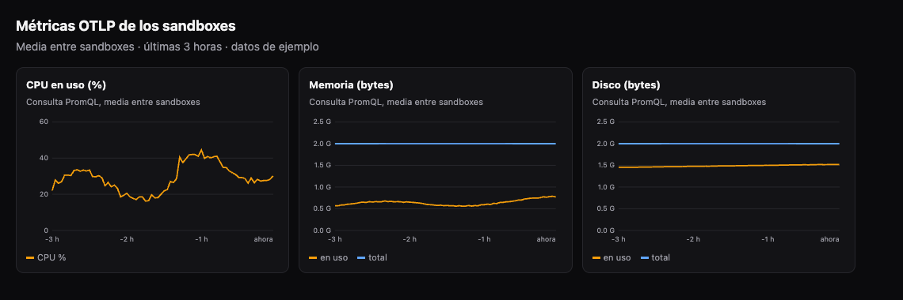
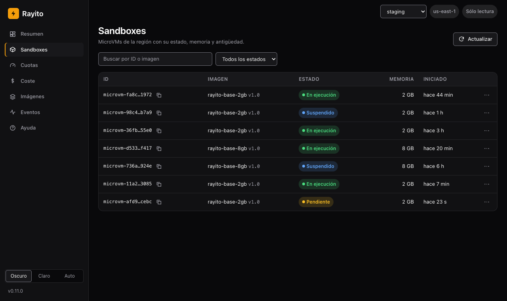
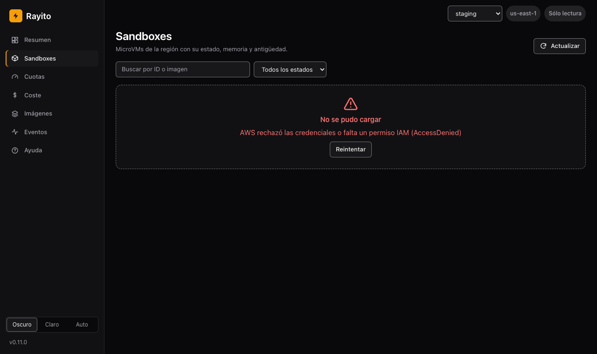

# Dashboard: CloudWatch dashboard, multiple accounts and quota alerts

Three optional extras of the [management dashboard](panel-de-gestion.md) (ADR-026,
phase 3). None turns on by itself and none needs a Rayito server: what
they create is yours and is deleted with `rayito stack destroy`.

The steps for each extra are in its section. Only the multi-account view carries
a screenshot: the CloudWatch dashboard and the SNS alerts are seen in the AWS
console, which shows your account's data, so here they go as text and sample
output. The [dashboard's guide with screenshots](panel-de-gestion.md#recorrido) covers
the rest, and the dashboard's **Help** entry summarizes it.

| Extra | What it is | Where it runs |
|---|---|---|
| [CloudWatch dashboard](#dashboard-de-cloudwatch) | The JSON of a dashboard with sandbox logs, OTLP metrics and quota usage | It is printed (no AWS) or the `dashboard-cloudwatch` stack is deployed |
| [Multiple accounts](#varias-cuentas) | `rayito dashboard --account` sees other accounts with a read-only role | Your laptop; the `dashboard-read-role` stack goes in each target account |
| [Quota alerts](#avisos-de-cuota) | A scheduled Lambda publishes to SNS when a quota threshold is crossed | The `quota-alerts` stack, in your account |

## CloudWatch dashboard { #dashboard-de-cloudwatch }

!!! info "Cost and activation"
    - **Default**: off. `rayito dashboard cloudwatch` only prints
      text: it needs no credentials and makes no AWS call. The
      `dashboard-cloudwatch` stack is not created until you deploy it.
    - **Turns on**: `rayito stack deploy dashboard-cloudwatch`, or
      `aws cloudwatch put-dashboard` with the JSON the CLI prints.
      `IncludeOtlp=true` and `IncludeQuota=true` add the optional charts.
    - **Resources and AWS calls**: a single `AWS::CloudWatch::Dashboard`; no
      function, role or data.
    - **Approximate cost**: **generating the JSON is free** (`rayito dashboard
      cloudwatch` does not call AWS); **deploying it costs**. $0 as long as you have
      fewer than 4 dashboards (the first 3, of up to 50 metrics, are
      free); above those 3, $3 a month per dashboard. Each Logs Insights
      widget runs its query every time you open or refresh the
      dashboard and CloudWatch bills the scanned data ($0.005 per GB):
      bound the time range. `--quota` (or `IncludeQuota=true`) charts
      the `quota-alerts` stack's metric, which costs ~$0.30 a month separately;
      the `--otlp` PromQL queries from the console are not billed
      ([CloudWatch pricing](https://aws.amazon.com/cloudwatch/pricing/),
      checked on 2026-10-13, us-east-1).
    - **IAM**: whoever deploys, what [Optional stacks](pilas-opcionales.md) requires
      plus `cloudwatch:PutDashboard`, `GetDashboard` and `DeleteDashboards`
      (CloudFormation acts with their permissions); whoever views it, `logs:StartQuery`
      and `logs:GetQueryResults` on the groups.
    - **How to turn it off**: `rayito stack destroy dashboard-cloudwatch`, or
      `aws cloudwatch delete-dashboards`.
    - **Example**: the one in the next section.

The dashboard carries five Logs Insights widgets (plus a header) over the `/rayito/*` groups
(the one the SDK uses with `logging="cloudwatch"`): lines per interval, errors
per interval, lines per group, noisiest streams and recent errors. With
`--otlp` it adds CPU, memory and disk from `rayd`'s
[OTLP metrics](exportacion-otlp.md); with `--quota`, the chart of
memory quota usage with the warning and critical thresholds as lines.

=== "CLI"

    ```bash
    # Only prints: no AWS call, not even credentials
    rayito --region us-east-1 dashboard cloudwatch > rayito-board.json
    rayito dashboard cloudwatch --otlp --quota --output rayito-board.json
    # Other log groups, or a prefix of your own
    rayito dashboard cloudwatch --log-group /rayito/base --log-group /rayito/agent
    rayito dashboard cloudwatch --log-group-prefix /rayito/team-a/
    # Creating it is up to you:
    aws cloudwatch put-dashboard --dashboard-name "$DASHBOARD_NAME" \
      --dashboard-body file://rayito-board.json
    ```

=== "Python"

    ```python
    from rayito import OptionalStacks

    stacks = OptionalStacks()  # does not call AWS
    status = stacks.deploy(
        "dashboard-cloudwatch",
        parameters={"IncludeOtlp": "true", "IncludeQuota": "true"},
        tags={"Owner": "my-team"},  # the tags your organization requires
    )
    print(status.outputs["DashboardName"])
    ```

=== "TypeScript"

    ```ts
    import { OptionalStacks } from "rayito";

    const status = await new OptionalStacks().deploy("dashboard-cloudwatch", {
      parameters: { IncludeOtlp: "true", IncludeQuota: "true" },
      tags: { Owner: "my-team" },
    });
    console.log(status.outputs.DashboardName);
    ```

**The dashboard name.** The stack does not fix a name: with the `DashboardName`
parameter empty (the default) the dashboard is named like the stack
(`rayito-dashboard-cloudwatch` unless you use `--stack-name`), which is already unique
in the region, so deploying does not clash with a dashboard of yours called
`rayito`. To choose another, pass it as a parameter (`--param
DashboardName=<name>`). A stack deployed before this change keeps the
name it already had: redeploying does not rename it.

The JSON the CLI prints and the one the stack deploys come from the same
generator, so they cannot diverge (a test checks it). The group
name and the prefix are validated before building any query: only letters,
numbers and `_ . # - /`.

### Try the OTLP charts { #probar-otlp }

The `--otlp` charts (or `IncludeOtlp=true`) only have data if some
sandbox exports its [OTLP metrics](exportacion-otlp.md), and that export
is **off by default**. To see the charts with data:

1. Deploy the export policy once in the account:
   `rayito stack deploy otlp-export`. It costs nothing at rest.
2. Create a sandbox with `telemetry=TelemetryExport(...)` (TypeScript:
   `telemetry: new TelemetryExport({...})`) on the `rayito-base-caps` image
   with your execution role, as the
   [OTLP export example](exportacion-otlp.md#ejemplo-rapido) shows. Each
   batch costs about $0.00002 per sandbox-hour at `interval_s=60`.
3. Wait at least two intervals (`interval_s`, 60 s by default) and check
   on the sandbox itself that the sending works:
   `sbx.get_telemetry_status()` should give `exported` greater than zero and
   `last_error_class` empty.
4. Deploy or update the dashboard with `IncludeOtlp=true` and open it in the
   CloudWatch console. The three charts (CPU, memory and disk) use
   PromQL queries with the metric name in quotes, because of the
   dots: `avg({"rayito.sandbox.cpu.used_pct"})`. If you export with
   `names="e2b"`, the metrics are called `e2b.sandbox.*` and these charts
   stay empty.
5. To turn it off, terminate the sandbox (`sbx.kill()`) and, if nobody uses it anymore,
   `rayito stack destroy otlp-export`. If you attached the
   `RayitoOtlpExport` policy to a role, detach it first: CloudFormation does not delete a
   policy that is still attached (`DELETE_FAILED`).

OTLP metrics do not appear in `ListMetrics`, so look for the series in
**Metrics → Query** in the console with PromQL, not in the classic explorer. This is
how the dashboard's three charts look with sample data (in your account
they will draw whatever your sandboxes export):

{ loading=lazy }

To check the data without opening the console, CloudWatch offers a PromQL HTTP
API (`https://monitoring.<region>.amazonaws.com/api/v1/query` and
`query_range`, signed with SigV4 for the `monitoring` service) that accepts the same
query as the widget:

```python
import json
import urllib.parse
import urllib.request

import boto3
from botocore.auth import SigV4Auth
from botocore.awsrequest import AWSRequest

session = boto3.Session(region_name="us-east-1")
query = urllib.parse.urlencode({"query": 'avg({"rayito.sandbox.cpu.used_pct"})'})
url = f"https://monitoring.us-east-1.amazonaws.com/api/v1/query?{query}"
request = AWSRequest(method="GET", url=url)
SigV4Auth(session.get_credentials().get_frozen_credentials(), "monitoring", "us-east-1").add_auth(request)
reply = urllib.request.urlopen(urllib.request.Request(url, headers=dict(request.headers)))
print(json.load(reply)["data"]["result"])
```

!!! info "Measured on real AWS"
    Tested on 2026-10-14 in us-east-1 with Python and TypeScript sandboxes
    (`interval_s=15`): the first batch arrives in seconds and the seven metrics
    answer the query with the name in quotes; without quotes, PromQL
    gives a syntax error. Each sandbox is a different series
    (`@resource.sandbox_id`). The log widgets' `SOURCE logGroups(namePrefix: [...])`
    runs in Logs Insights and returns results. What could not
    be checked through the API is how the console draws the PromQL widgets
    (`GetMetricWidgetImage` does not support them). Detail: `AWS_API_NOTES.md` §30,
    Q167.

## Multiple accounts { #varias-cuentas }

!!! info "Cost and activation"
    - **Default**: off. `rayito dashboard` without `--account` sees only the
      account of your credentials, and STS is not called.
    - **Turns on**: `rayito dashboard --account NAME=ROLE_ARN`, repeatable
      up to {{dashboardAccountsMax}} accounts, after deploying
      `dashboard-read-role` in each target account.
    - **Resources and AWS calls**: in each target account, a read-only
      `AWS::IAM::Role`. In the dashboard, one `sts:AssumeRole` per account (when requesting its
      view for the first time and when renewing every hour) and the same reads as
      the single-account dashboard: `ListMicrovms`, `ListMicrovmImages`,
      `Get/ListMicrovmImageVersion` and `ListServiceQuotas`.
    - **Approximate cost**: $0. IAM and STS do not bill; the reads have no
      price ([IAM](https://aws.amazon.com/iam/pricing/), checked on
      2026-10-13).
    - **IAM**: the dashboard's identity needs `sts:AssumeRole` on those
      roles; each target role only allows the five reads above.
    - **How to turn it off**: do not pass `--account`; `rayito stack destroy
      dashboard-read-role` in each target account deletes the role.
    - **Example**: the one in this section.

The multi-account view belongs to the **local** dashboard (`rayito dashboard`). The additional
accounts are **always read-only**: no actions, no billed cost,
no logs and no events. The page's selector only shows the names you
chose; the role's ARN and the account id do not come out through the API.

**1. In each target account**, deploy the read role. It trusts the
identity that runs the dashboard (never the account root) and, if you want,
requires an `ExternalId`:

=== "CLI"

    ```bash
    rayito --profile <target-account-profile> stack deploy dashboard-read-role \
      --param TrustedPrincipalArn=arn:aws:iam::123456789012:role/rayito-panel \
      --param ExternalId=a-long-random-value
    rayito --profile <target-account-profile> stack status dashboard-read-role   # RoleArn
    ```

=== "Python"

    ```python
    from rayito import OptionalStacks

    status = OptionalStacks().deploy(
        "dashboard-read-role",
        parameters={
            "TrustedPrincipalArn": "arn:aws:iam::123456789012:role/rayito-panel",
            "ExternalId": "a-long-random-value",
        },
    )
    print(status.outputs["RoleArn"])
    ```

=== "TypeScript"

    ```ts
    import { OptionalStacks } from "rayito";

    const status = await new OptionalStacks().deploy("dashboard-read-role", {
      parameters: {
        TrustedPrincipalArn: "arn:aws:iam::123456789012:role/rayito-panel",
        ExternalId: "a-long-random-value",
      },
    });
    console.log(status.outputs.RoleArn);
    ```

**2. In the dashboard's account**, give your identity permission to assume those
roles and start the dashboard with them:

```json
{
  "Effect": "Allow",
  "Action": "sts:AssumeRole",
  "Resource": "arn:aws:iam::123456789012:role/rayito-dashboard-read-*"
}
```

```bash
rayito dashboard \
  --account staging=arn:aws:iam::123456789012:role/rayito-dashboard-read-AbC123 \
  --external-id a-long-random-value
# Panel de Rayito (us-east-1, sólo lectura, más 1 cuenta de sólo lectura). Ábrelo en tu navegador:
```

**3. Switch accounts.** With one or more additional accounts, the top
right corner shows a selector with **This account** and the name of each one. The additional
ones are always **read-only**. The screenshot uses sample accounts.

{ loading=lazy }

**Without writing accounts in the command.** None of this requires ARNs in a file or
in the shell history: the target account can come only from environment
variables and be assembled at run time. `--account` is also read from
`RAYITO_DASHBOARD_ACCOUNTS` (`NAME=ARN` entries separated by spaces) and the
`ExternalId`, from `RAYITO_DASHBOARD_EXTERNAL_ID`:

```bash
export TARGET_ACCOUNT_ID=<target-account-id>   # you set it, never in the repo
export TARGET_ROLE_NAME=<read-role-name>  # the stack's RoleArn output
export RAYITO_DASHBOARD_ACCOUNTS="staging=arn:aws:iam::${TARGET_ACCOUNT_ID}:role/${TARGET_ROLE_NAME}"
export RAYITO_DASHBOARD_EXTERNAL_ID=<the-same-value-as-the-stack>
rayito dashboard
```

The template, the dashboard and the identity's policy are account-independent:
only the role's ARN changes, and it arrives at run time. To check a target account end to end: deploy `dashboard-read-role`
in it (step 1), export the variables, start `rayito dashboard` and pick the
account in the selector; an account that rejects the role shows up with the code
`AccessDenied`. If what you want is to check that the role cannot act, do not
test it with a made-up MicroVM id: AWS answers `ResourceNotFoundException`
before authorizing. Use the IAM simulator (`aws iam simulate-principal-policy`
on the role) or a real MicroVM.

This is what an account whose role rejects the dashboard looks like (for example, an `ExternalId`
that does not match): the page shows the AWS code and nothing else.

{ loading=lazy }

The `ExternalId` is the same for all accounts. If an account rejects the role, the page says so with the
AWS code (`AccessDenied`) and without the message, which would name the role and account. The
assumed session lasts {{dashboardAssumeRoleSessionSeconds}} s and renews itself.

The `dashboard` stack **in your account** does not include the multi-account view yet: only
the local dashboard has it.

## Quota alerts { #avisos-de-cuota }

!!! info "Cost and activation"
    - **Default**: off. Nothing is created until you run
      `rayito stack deploy quota-alerts`.
    - **Turns on**: `rayito stack deploy quota-alerts --artifact-bucket <bucket>`.
      `--param NotificationEmail=...` subscribes an email to the topic; `--param
      TopicArn=...` uses a topic of yours; `WarningPercent` and `CriticalPercent`
      change the thresholds and `ScheduleExpression` the frequency.
    - **Resources and AWS calls**: a Lambda with its log group, an
      EventBridge rule, an SNS topic (except with `TopicArn`) and its subscription, an
      on-demand DynamoDB table with one row and an IAM role. Each run
      lists the MicroVMs and the region's quotas and publishes a custom
      metric.
    - **Approximate cost**: ~$0.30 a month for the custom metric
      (`{{quotaMetricNamespace}}`); Lambda (~720 runs a month with
      `{{quotaAlertsScheduleExpression}}`), EventBridge, DynamoDB and SNS by
      email fit in their free tiers
      ([CloudWatch](https://aws.amazon.com/cloudwatch/pricing/),
      [Lambda](https://aws.amazon.com/lambda/pricing/),
      [SNS](https://aws.amazon.com/sns/pricing/); checked on 2026-10-13,
      us-east-1).
    - **IAM**: whoever deploys needs `CAPABILITY_IAM`. The function only reads
      MicroVMs and quotas; it writes to SNS (`sns:Publish` on its topic), to its
      DynamoDB row and to its CloudWatch namespace
      (`cloudwatch:namespace`).
    - **How to turn it off**: `rayito stack destroy quota-alerts`. It deletes everything,
      including the topic it created (not the `TopicArn` one).
    - **Example**: the one in this section.

=== "CLI"

    ```bash
    rayito stack deploy quota-alerts --artifact-bucket my-bucket \
      --param NotificationEmail=ops@example.com --param WarningPercent=70
    # Test the wiring without waiting for the schedule:
    aws lambda invoke --function-name <FunctionName> /dev/stdout
    rayito stack destroy quota-alerts
    ```

=== "Python"

    ```python
    from rayito import OptionalStacks

    stacks = OptionalStacks()  # does not call AWS
    status = stacks.deploy(
        "quota-alerts",
        artifact_bucket="my-bucket",
        parameters={"NotificationEmail": "ops@example.com", "WarningPercent": "70"},
        tags={"Owner": "my-team"},
    )
    print(status.outputs["TopicArn"])
    ```

=== "TypeScript"

    ```ts
    import { OptionalStacks } from "rayito";

    const status = await new OptionalStacks().deploy("quota-alerts", {
      artifactBucket: "my-bucket",
      parameters: { NotificationEmail: "ops@example.com", WarningPercent: "70" },
      tags: { Owner: "my-team" },
    });
    console.log(status.outputs.TopicArn);
    ```

The function measures the allocated memory (`RUNNING` plus suspended) against the region's
quota, like the dashboard's quotas tab, and classifies usage with
the thresholds ({{quotaWarningFraction}} and {{quotaCriticalFraction}} of the quota
by default, as a percentage in the stack). It alerts **once per crossing**: when the
level goes up (from normal to high, from high to critical) and not on every run
while it holds. It remembers the highest level reached until usage
goes back to normal, so usage that oscillates around the critical threshold alerts
once and not every time it crosses; when it drops to normal, the next crossing alerts
again. If SNS fails, the run fails and the next cycle retries the alert.

The message carries the region, the allocated memory and the quota, and how many sandboxes
count; never sandbox ids, image names or account names. If the memory of some sandbox
could not be read, it says so: actual usage may be higher.

Each stack watches **one region**: deploy one per region. The
`{{quotaMetricNamespace}}/{{quotaMetricName}}` metric (dimension `Region`) is what
the [CloudWatch dashboard](#dashboard-de-cloudwatch) draws with `--quota`. The
SNS topic is not encrypted: the message carries no sensitive data.

## Minimum IAM { #iam-minimo }

| Who | What it allows | Where |
|---|---|---|
| `quota-alerts` function role | `lambda:ListMicrovms`, `lambda:GetMicrovmImageVersion` (the account's images), `servicequotas:ListServiceQuotas`, `sns:Publish` on its topic, `dynamodb:GetItem`/`PutItem` on its table, `cloudwatch:PutMetricData` only with `cloudwatch:namespace` equal to `{{quotaMetricNamespace}}` | `infra/quota-alerts.yaml` |
| `dashboard-read-role` role | `lambda:ListMicrovms`, `ListMicrovmImages`, `ListMicrovmImageVersions`, `GetMicrovmImageVersion`, `servicequotas:ListServiceQuotas`; no writes | `infra/dashboard-read-role.yaml` |
| Local dashboard identity with `--account` | `sts:AssumeRole` on those roles | your policy |

None of the three stacks creates CloudFront or buckets, and the alerts stack's
Lambda is created by CloudFormation.

## See also { #ver-tambien }

- [Management dashboard](panel-de-gestion.md) and [Dashboard in your account](panel-en-tu-cuenta.md)
- [Optional stacks](pilas-opcionales.md)
- [OTLP export](exportacion-otlp.md)
- [Dashboard API](../referencia/api-del-panel.md)
