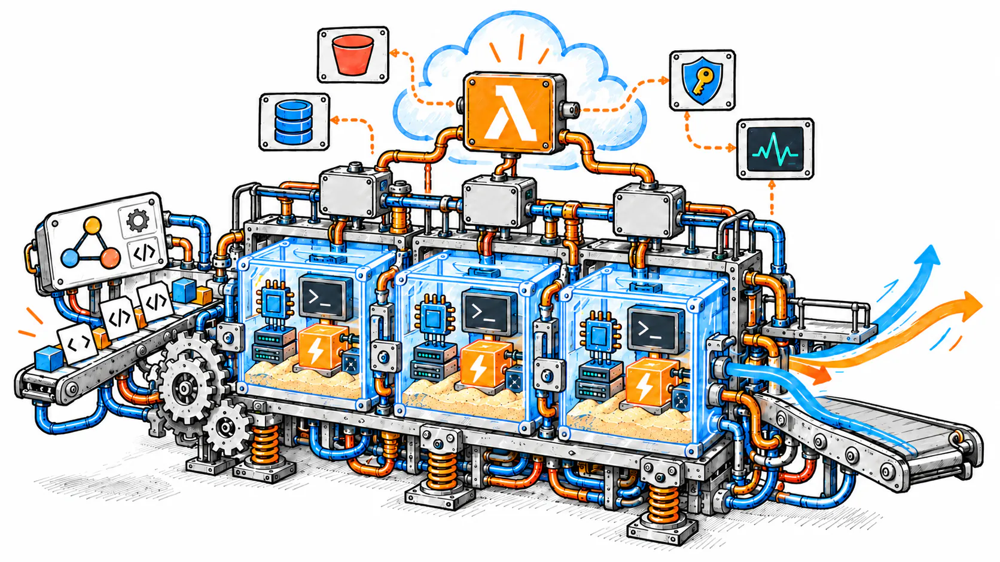

<div class="rx-hero" markdown>
<div class="rx-hero__copy" markdown>

[Nuevo en 0.14: despliega el agente que ya tienes, sin configuración, en Python y TypeScript](novedades/0.14.0.md){ .rx-pill }

# Sandboxes para agentes de IA, en tu propia cuenta de AWS { .rx-hero__title }

Cada sandbox es un MicroVM de AWS Lambda aislado por hardware. El SDK llama
directamente a la API de AWS con tus credenciales: sin servidor de Rayito ni API key,
y con la misma API que E2B.
{ .rx-hero__lead }

<div class="rx-hero__actions" markdown>
[Empezar](primeros-pasos/index.md){ .md-button .md-button--primary }
[:fontawesome-brands-github: Ver en GitHub](https://github.com/alejandro-cedeno-10/rayito){ .md-button }
</div>

¿Vienes de E2B? [Cambia un import](migrar-desde-e2b/index.md). Gratis y Apache-2.0: pagas sólo AWS.
{ .rx-hero__note }

</div>
<div class="rx-hero__code" markdown>

<div class="rx-window" aria-hidden="true"><span></span><span></span><span></span></div>

=== "Python"

    ```bash
    pip install rayito
    ```

    ```python
    from rayito import Sandbox

    with Sandbox.create() as sbx:
        print(sbx.commands.run("echo hola").stdout)  # "hola\n"
        print(sbx.run_code("x = 40; x + 2").text)  # "42"
    ```

=== "TypeScript"

    ```bash
    pnpm add rayito
    ```

    ```ts
    import { Sandbox } from "rayito";

    await using sbx = await Sandbox.create();
    console.log((await sbx.commands.run("echo hola")).stdout); // "hola\n"
    console.log((await sbx.runCode("x = 40; x + 2")).text); // "42"
    ```

<p class="rx-hero__foot" markdown>Necesita la imagen `rayito-base` en tu cuenta: [Configurar AWS](primeros-pasos/configurar-aws.md), una vez.</p>

</div>
</div>

<div class="rx-ruler">
<div class="rx-ruler__figure" role="img" aria-label="Tiempos medidos: resume 0,38 s; pool.take 0,77 s; listo para comandos 2,3 s; kernel listo 5,2 s">
<div class="rx-ruler__track">
<span class="rx-ruler__tick" style="--s:0"><span>0 s</span></span>
<span class="rx-ruler__tick" style="--s:1"><span>1 s</span></span>
<span class="rx-ruler__tick" style="--s:2"><span>2 s</span></span>
<span class="rx-ruler__tick" style="--s:3"><span>3 s</span></span>
<span class="rx-ruler__tick" style="--s:4"><span>4 s</span></span>
<span class="rx-ruler__tick" style="--s:5"><span>5 s</span></span>
<span class="rx-ruler__tick" style="--s:6"><span>6 s</span></span>
<span class="rx-ruler__mark rx-ruler__mark--up" style="--s:0.38"><span class="rx-ruler__value">0,38 s</span><span class="rx-ruler__label"><code>resume()</code></span></span>
<span class="rx-ruler__mark rx-ruler__mark--down" style="--s:0.77"><span class="rx-ruler__value">0,77 s</span><span class="rx-ruler__label"><code>pool.take()</code></span></span>
<span class="rx-ruler__mark rx-ruler__mark--up" style="--s:2.3"><span class="rx-ruler__value">2,3 s</span><span class="rx-ruler__label">listo para comandos</span></span>
<span class="rx-ruler__mark rx-ruler__mark--down rx-ruler__mark--end" style="--s:5.2"><span class="rx-ruler__value">5,2 s</span><span class="rx-ruler__label">kernel listo</span></span>
</div>
</div>
<p class="rx-ruler__note">Medianas medidas en AWS real (us-east-1, 2026-09). Detalle en <a href="cost/#tiempos">Tiempos</a>.</p>
</div>

## Por qué Rayito { .rx-sr-only #por-que-rayito }

<div class="rx-hooks" markdown>

<div class="rx-hook" markdown>

### Un sandbox en segundos { #un-sandbox-en-segundos }

`Sandbox.create()` deja el sandbox listo para comandos en unos 2,3 s y el
kernel de Python en unos 5,2 s. Desde un pool de sandboxes suspendidos, en
menos de un segundo.

[Pool](pool.md) · [Tiempos medidos](cost.md#tiempos)

</div>
<div class="rx-hook" markdown>

### Un agente de código dentro { #un-agente-de-codigo-dentro }

`sbx.agent.run()` corre OpenCode o deepagents en el propio sandbox. El
modelo (Bedrock, Anthropic, OpenAI y [más proveedores](guias/agente-proveedores.md)) se
llama a través de la pasarela de secretos: el agente usa la credencial, pero
no puede leerla.

[Agente en el sandbox](guias/agente-en-el-sandbox.md)

</div>
<div class="rx-hook" markdown>

### De E2B en un import { #de-e2b-en-un-import }

```diff
- from e2b_code_interpreter import Sandbox
+ from rayito.e2b import Sandbox
```

Lo que Lambda MicroVMs no puede hacer lanza `UnimplementedError`: nada se
aproxima en silencio.

[Migrar desde E2B](migrar-desde-e2b/index.md) · [Paridad, fila a fila](e2b-parity.md)

</div>

</div>

<div class="rx-section" markdown>

## Cómo funciona { #como-funciona }

Tu código pide un sandbox; AWS Lambda lo arranca en tu cuenta y te
devuelve el resultado.
{ .rx-section__lead }

<figure class="rx-art" data-rx-art>
<div class="rx-art__stage" role="img" aria-label="Ilustración de Rayito: un agente envía código a tres sandboxes aislados sobre MicroVMs de AWS Lambda; dos gatos operan la máquina y los resultados salen por una cinta.">



<span class="rx-art__l rx-art__male" aria-hidden="true">


</span>
<span class="rx-art__l rx-art__female" aria-hidden="true">


</span>

<span class="rx-art__l rx-art__cube" aria-hidden="true"><span class="rx-art__cube-bob">


</span></span>


<span class="rx-art__l rx-art__glow rx-art__glow--0" style="--i:0" aria-hidden="true"></span>
<span class="rx-art__l rx-art__glow rx-art__glow--1" style="--i:1" aria-hidden="true"></span>
<span class="rx-art__l rx-art__glow rx-art__glow--2" style="--i:2" aria-hidden="true"></span>
<span class="rx-art__l rx-art__dot rx-art__dot--0" style="--n:0" aria-hidden="true"></span>
<span class="rx-art__l rx-art__dot rx-art__dot--1" style="--n:1" aria-hidden="true"></span>
<span class="rx-art__l rx-art__dot rx-art__dot--2" style="--n:2" aria-hidden="true"></span>
<span class="rx-art__l rx-art__dot rx-art__dot--3" style="--n:1" aria-hidden="true"></span>
<span class="rx-art__l rx-art__dot rx-art__dot--4" style="--n:2" aria-hidden="true"></span>
<span class="rx-art__l rx-art__dot rx-art__dot--5" style="--n:3" aria-hidden="true"></span>
<span class="rx-art__l rx-art__dot rx-art__dot--6" style="--n:2" aria-hidden="true"></span>
<span class="rx-art__l rx-art__dot rx-art__dot--7" style="--n:3" aria-hidden="true"></span>
<span class="rx-art__l rx-art__dot rx-art__dot--8" style="--n:4" aria-hidden="true"></span>
<span class="rx-art__l rx-art__signal" aria-hidden="true"></span>
</div>
<figcaption><ol><li>Tu agente o tu código llama al SDK con tus credenciales de AWS.</li><li>Cada sandbox arranca en su propio MicroVM de Lambda, aislado por hardware.</li><li>Salidas, ficheros y artefactos vuelven a tu código; nada pasa por un servidor de Rayito.</li></ol></figcaption>
<button type="button" class="rx-art__toggle" data-rx-art-toggle aria-label="Pausar animación" aria-pressed="false" hidden><span class="rx-art__icon" aria-hidden="true"></span></button>
</figure>

<div class="rx-actions" markdown>
[Pruébalo en local, sin cuenta de AWS](guias/probar-en-local.md){ .md-button }
</div>

</div>

<div class="rx-section" markdown>

## Empieza en tres pasos { #empieza-en-tres-pasos }

<div class="rx-steps" markdown>
<div class="rx-step" markdown>

### Instala el SDK { #instala-el-sdk }

Python ≥ 3.11 o Node ≥ 20. La CLI (`rayito doctor`) se instala con pip.

=== "Python"

    ```bash
    pip install "rayito[cli]"
    ```

=== "TypeScript"

    ```bash
    pnpm add rayito
    npx rayito doctor          # la CLI también viene en el paquete npm
    ```

[Instalación](primeros-pasos/instalacion.md)

</div>
<div class="rx-step" markdown>

### Prepara tu cuenta, una vez { #prepara-tu-cuenta-una-vez }

Una sola orden, `rayito setup`, prepara la cuenta y la región: pila de IAM,
imagen `rayito-base` y el bucket que ya tengas (no crea buckets). Muestra el
plan y el coste y pide confirmación. La imagen tarda unos 10 minutos en
construirse, una vez por cuenta y región. `rayito doctor` es la comprobación.

=== "Python"

    ```bash
    export AWS_PROFILE=<tu-perfil>
    export AWS_REGION=us-east-1
    rayito setup --dry-run     # sólo lee: muestra el plan y el coste
    rayito setup
    rayito doctor --template rayito-base
    ```

=== "TypeScript"

    ```bash
    export AWS_PROFILE=<tu-perfil>
    export AWS_REGION=us-east-1
    npx rayito setup --dry-run
    npx rayito setup
    npx rayito doctor --template rayito-base
    ```

[Configurar AWS](primeros-pasos/configurar-aws.md)

</div>
<div class="rx-step" markdown>

### Lanza tu primer sandbox { #lanza-tu-primer-sandbox }

Guarda el código del inicio en `primer.py` (o `primer.ts`) y ejecútalo.

=== "Python"

    ```bash
    python primer.py
    ```

=== "TypeScript"

    ```bash
    npx tsx primer.ts
    ```

[Primer sandbox](quickstart.md)

</div>
</div>

<div class="rx-actions rx-actions--steps" markdown>
[Lanza tu primer sandbox](quickstart.md){ .md-button .md-button--primary }
</div>

</div>

<div class="rx-section rx-split" markdown>
<div class="rx-split__copy" markdown>

<p class="rx-eyebrow">Agentes</p>

## Un agente de código dentro del sandbox { #un-agente-de-codigo-dentro-del-sandbox }

Basta un `Sandbox.create()` sobre la imagen `rayito-agent`. Con
`allow_internet_access=False` el sandbox sólo llega al modelo, por la
pasarela de secretos. El agente es [OpenCode](https://github.com/anomalyco/opencode)
o deepagents, y el proveedor, el que prefieras (ver
[Proveedores del agente](guias/agente-proveedores.md)).

[Templates de agente](funciones-opcionales/templates-de-agente.md) ·
[¿Arranque rápido? Qué uso](guias/agente-en-el-sandbox.md#que-uso) ·
[VM frente a tokens](cost.md#coste-de-un-agente-vm-frente-a-modelo)

<div class="rx-actions" markdown>
[Lee la guía del agente](guias/agente-en-el-sandbox.md){ .md-button .md-button--primary }
[Elige proveedor de modelo](guias/agente-proveedores.md)
</div>

</div>
<div class="rx-split__code" markdown>

=== "Python"

    ```python
    from rayito import AgentModel, AgentSpec, Sandbox, SecretStore, bedrock_gateway

    MODEL_ID = "us.anthropic.claude-haiku-4-5-20251001-v1:0"
    SecretStore().create("bedrock-key", "Bearer <clave de Bedrock de corta duración>")
    spec = AgentSpec(model=AgentModel(provider="bedrock", id=MODEL_ID, gateway="bedrock", region="us-east-1"))

    with Sandbox.create(
        template="rayito-agent",
        allow_internet_access=False,
        gateways={"bedrock": bedrock_gateway("bedrock-key", region="us-east-1", models=[MODEL_ID])},
    ) as sbx:
        result = sbx.agent.run("Lista los ficheros de /home/user y resume qué hay.", spec=spec)
        print(result.text, result.usage.total)
    ```

=== "TypeScript"

    ```ts
    import { AgentModel, AgentSpec, Sandbox, SecretStore, bedrockGateway } from "rayito";

    const MODEL_ID = "us.anthropic.claude-haiku-4-5-20251001-v1:0";
    await new SecretStore().create("bedrock-key", "Bearer <clave de Bedrock de corta duración>");
    const spec = new AgentSpec({
      model: new AgentModel({ provider: "bedrock", id: MODEL_ID, gateway: "bedrock", region: "us-east-1" }),
    });

    await using sbx = await Sandbox.create({
      template: "rayito-agent",
      allowInternetAccess: false,
      gateways: { bedrock: bedrockGateway("bedrock-key", { region: "us-east-1", models: [MODEL_ID] }) },
    });
    const result = await sbx.agent.run("Lista los ficheros de /home/user y resume qué hay.", { spec });
    console.log(result.text, result.usage.total);
    ```

</div>
</div>

<div class="rx-section rx-split" markdown>
<div class="rx-split__copy" markdown>

<p class="rx-eyebrow">Despliegue</p>

## Despliega tu agente en un comando { #despliega-tu-agente-en-un-comando }

Instala el SDK y ejecuta `rayito agent deploy ./mi-agente` (o `deploy_agent` /
`deployAgent`). El SDK detecta el framework, el punto de entrada y el
protocolo leyendo tus ficheros, sin ejecutar tu código. El modelo se llama por
la pasarela de secretos, así que el agente nunca ve la credencial. Y ajustas lo
que importa: memoria, sesiones simultáneas, cola, pool de MicroVMs, variables
de entorno y salida a internet.

<ul class="rx-chips" aria-label="Frameworks compatibles">
<li>LangGraph y LangGraph.js</li>
<li>LangChain</li>
<li>Deep Agents</li>
<li>Strands y Strands harness</li>
<li>Hermes</li>
<li>OpenCode</li>
<li>Vercel AI SDK</li>
<li>Tu propia app HTTP</li>
</ul>

<div class="rx-actions" markdown>
[Despliega tu agente](guias/despliega-tu-agente.md){ .md-button .md-button--primary }
[Flota de agentes](guias/flota-de-agentes.md)
</div>

</div>
<div class="rx-split__code" markdown>

=== "CLI"

    ```bash
    rayito agent deploy ./mi-agente --dry-run   # solo detección, sin AWS
    rayito agent deploy ./mi-agente --memory 4096 --max-sessions 2 --queue 4
    ```

=== "Python"

    ```python
    from rayito import AgentDeployOptions, deploy_agent

    fleet = deploy_agent("./mi-agente", options=AgentDeployOptions(bucket="amzn-s3-demo-bucket"))
    try:
        print(fleet.invoke("Resume el README.").text)
    finally:
        fleet.stop()
    ```

=== "TypeScript"

    ```ts
    import { deployAgent } from "rayito";

    const fleet = await deployAgent("./mi-agente", { options: { bucket: "amzn-s3-demo-bucket" } });
    try {
      console.log((await fleet.invoke("Resume el README.")).text);
    } finally {
      await fleet.stop();
    }
    ```

</div>
</div>

<div class="rx-section rx-split rx-split--stack" markdown>
<div class="rx-split__copy" markdown>

## Un panel para ver y operar tus sandboxes { #un-panel-para-ver-y-operar-tus-sandboxes }

`rayito dashboard` abre en tu navegador un panel local con los sandboxes,
las cuotas, el coste y las imágenes de tu cuenta. Es de sólo lectura salvo
que pases `--allow-actions`, y no hay servidor de terceros.
[Recorrido paso a paso](funciones-opcionales/panel-de-gestion.md#recorrido) ·
[Desplegarlo en tu cuenta](funciones-opcionales/panel-en-tu-cuenta.md#recorrido)

{ loading=lazy width=1280 height=760 }

</div>
</div>

<div class="rx-section" markdown>

## Lo que viene incluido { #lo-que-viene-incluido }

<div class="rx-features" markdown>

<div class="rx-feature" markdown>
:material-pause-circle-outline:{ .lg .middle } [**Pausar y reanudar**](guias/pausar-reanudar.md)

Congela el sandbox con su estado y vuelve en 0,38 s.
</div>
<div class="rx-feature" markdown>
:material-layers-outline:{ .lg .middle } [**Pool**](pool.md)

Sandboxes suspendidos listos en menos de un segundo.
</div>
<div class="rx-feature" markdown>
:material-database-outline:{ .lg .middle } [**Persistencia**](persistence.md)

El `HOME` en S3, más allá de las 8 h.
</div>
<div class="rx-feature" markdown>
:material-shield-off-outline:{ .lg .middle } [**Red saliente**](network.md)

Corta o filtra la salida a internet.
</div>
<div class="rx-feature" markdown>
:material-server-network:{ .lg .middle } [**Servidor MCP**](mcp.md)

Un sandbox para tu editor o asistente por MCP.
</div>
<div class="rx-feature" markdown>
:material-link-variant:{ .lg .middle } [**LangChain y Vercel AI**](guias/langchain-y-vercel-ai.md)

Rayito como herramienta de tu agente.
</div>
<div class="rx-feature" markdown>
:material-cube-outline:{ .lg .middle } [**Templates**](funciones-opcionales/templates.md)

Imágenes propias con el DSL `Template` de E2B.
</div>
<div class="rx-feature" markdown>
:material-chart-line:{ .lg .middle } [**Exportación OTLP**](funciones-opcionales/exportacion-otlp.md)

Métricas del sandbox por OTLP a CloudWatch.
</div>

</div>

</div>

<div class="rx-section rx-split" markdown>
<div class="rx-split__copy" markdown>

## Migra desde E2B en minutos { #migra-desde-e2b-en-minutos }

`rayito.e2b` y `rayito/e2b` aceptan el código escrito para E2B 2.x. Cambia
el import, prepara tu cuenta y ejecuta.

- Mismas clases y métodos: `Sandbox`, `commands`, `files`, `run_code`.
- Lo que no existe en Lambda MicroVMs lanza `UnimplementedError` con enlace
  a la explicación.
- La [tabla de paridad](e2b-parity.md) lo dice fila a fila.

<div class="rx-actions" markdown>
[Migrar desde E2B](migrar-desde-e2b/index.md){ .md-button }
[Paridad, fila a fila](e2b-parity.md)
</div>

</div>
<div class="rx-split__code" markdown>

=== "Python"

    ```diff
    - from e2b_code_interpreter import Sandbox
    + from rayito.e2b import Sandbox
    ```

=== "TypeScript"

    ```diff
    - import { Sandbox } from "@e2b/code-interpreter";
    + import { Sandbox } from "rayito/e2b";
    ```

</div>
</div>

<div class="rx-band" markdown>

## Tu cuenta, tu factura { #tu-cuenta-tu-factura }

Los sandboxes corren en tu cuenta de AWS y se pagan en tu factura de AWS. No
hay servidor de Rayito, ni suscripción, ni API key. Las funciones con coste
propio están apagadas hasta que pasas su opción, y `rayito stack deploy` te
enseña el coste antes de pedir confirmación.
{ .rx-section__lead }

<div class="rx-band__figures" markdown>
<p class="rx-figure"><strong>≈ $0,126/h</strong><span>un sandbox de 2 GB mientras corre</span></p>
<p class="rx-figure"><strong>≈ $0,022</strong><span>diez minutos, con el lanzamiento</span></p>
<p class="rx-figure"><strong>≈ $0,60/mes</strong><span>una plaza de pool suspendida</span></p>
<p class="rx-figure"><strong>$0</strong><span>lo que cobra Rayito</span></p>
</div>

us-east-1, precios de lista consultados el 2026-10-06.
[Precios](cost.md) · [Funciones opcionales y su coste](optional-features.md)

</div>

<div class="rx-section" markdown>

## Explora el manual { #explora-el-manual }

<div class="grid cards rx-cards" markdown>

-   :material-rocket-launch:{ .lg .middle } **[Primeros pasos](primeros-pasos/index.md)**

    ---

    Instala el SDK, prepara tu cuenta de AWS y lanza tu primer sandbox.

-   :material-book-open-variant:{ .lg .middle } **[Guías](guias/index.md)**

    ---

    Una página por función: comandos, código, ficheros, red, pausa, pool y
    persistencia.

-   :material-robot-outline:{ .lg .middle } **[Agentes](guias/agente-en-el-sandbox.md)**

    ---

    El agente dentro del sandbox, el [servidor MCP](mcp.md) y las
    integraciones con LangChain y Vercel AI.

-   :material-toggle-switch-outline:{ .lg .middle } **[Funciones opcionales](optional-features.md)**

    ---

    Qué activa cada una, qué cuesta y cómo apagarla.

-   :material-swap-horizontal:{ .lg .middle } **[Migrar desde E2B](migrar-desde-e2b/index.md)**

    ---

    Qué cambia, qué no y qué no existe en Lambda MicroVMs.

-   :material-api:{ .lg .middle } **[Referencia](referencia/index.md)**

    ---

    API de Python y TypeScript, CLI, errores, variables de entorno y límites.

-   :material-server-security:{ .lg .middle } **[Operación](operacion/index.md)**

    ---

    Imágenes, IAM, seguridad, precios y solución de problemas.

-   :material-new-box:{ .lg .middle } **[Novedades](novedades/index.md)**

    ---

    Qué trae cada versión y cómo actualizar.

</div>

</div>

<div class="rx-incluye" markdown>

??? info "Qué incluye: todas las superficies"

    | Superficie | Qué hace | Guía |
    |---|---|---|
    | `Sandbox.create / connect / kill / list / get_info` | ciclo de vida del MicroVM, metadatos y plazos | [Ciclo de vida](guias/ciclo-de-vida.md) |
    | `pause()` / `resume()`, `IdlePolicy` | suspender y reanudar con todo el estado vivo | [Pausar y reanudar](guias/pausar-reanudar.md) |
    | `timeout`, `max_lifetime`, `on_timeout`, `set_timeout()` | un plazo que `rayd` impone aunque tu proceso muera | [Plazo del servidor](lifecycle.md) |
    | `sbx.commands` | procesos en primer y segundo plano, `stdin`, `kill`, reconexión | [Comandos](guias/comandos.md) |
    | `sbx.run_code` | kernel Jupyter con estado, resultados, logs, errores y gráficos | [Ejecutar código](guias/ejecutar-codigo.md) |
    | `run_code(language="bash" / "javascript" / "typescript")` | kernels bash y Deno en `rayito-base-poly` | [Lenguajes y kernels](kernels.md) |
    | `sbx.pty` | terminales reales con `resize` y reconexión | [Terminal (PTY)](guias/terminal-pty.md) |
    | `sbx.files` | leer, escribir, listar y vigilar; ficheros grandes y URLs firmadas por S3 | [Ficheros y S3](files.md) |
    | `sbx.get_host(port)` | acceso HTTP a un puerto del sandbox | [Puertos y host](guias/puertos-y-host.md) |
    | `network=`, `allow_internet_access=False` | política de salida a internet de E2B en `rayito-base-caps` | [Red saliente](network.md) |
    | `SandboxPool` | sandboxes en menos de un segundo desde un pool de suspendidos | [Pool](pool.md) |
    | `persist=`, `reincarnate()` | el `HOME` en S3, más allá de las 8 h | [Persistencia](persistence.md) |
    | `get_metrics_history()`, `Sandbox.paginate()` | historial de métricas y listado reanudable | [Métricas y listado](observability.md) |
    | `sbx.git` | la API git de E2B | [Git](git.md) |
    | `sbx.agent` | un agente de código (OpenCode o deepagents) dentro del sandbox, con el modelo tras la pasarela de secretos | [Agente en el sandbox](guias/agente-en-el-sandbox.md) |
    | `rayito.e2b`, `rayito/e2b` | el SDK de E2B 2.x cambiando sólo el import | [Migrar desde E2B](migrar-desde-e2b/index.md) |
    | `rayito-mcp` | un sandbox para Claude Code, Cursor o VS Code por MCP | [Servidor MCP](mcp.md) |
    | LangChain, Vercel AI SDK | Rayito como herramienta de un agente que corre fuera del sandbox | [LangChain y Vercel AI](guias/langchain-y-vercel-ai.md) |
    | `rayito` (CLI) | publicar la imagen, diagnosticar la cuenta, operar sandboxes y pilas | [CLI](cli.md) |
    | `make local-up`, `make local-e2e` | probar los SDK contra un `rayd` real y un AWS emulado, sin cuenta | [Probar en local](guias/probar-en-local.md) |

    Funciones opcionales, todas apagadas por defecto hasta que pasas su opción
    (o, en las que son sólo de la CLI, ejecutas su orden):

    | Superficie | Qué hace | Guía |
    |---|---|---|
    | `secrets=`, `SecretStore` | secretos de AWS Secrets Manager como variables de entorno | [Secretos](secrets.md) |
    | `gateways=`, `SecretGateway` | usar un secreto desde el sandbox sin poder leerlo | [Pasarela de secretos](funciones-opcionales/pasarela-de-secretos.md) |
    | `mounts=`, `S3Mount` | un bucket S3 como carpeta del sandbox | [Montajes S3](funciones-opcionales/montajes-s3.md) |
    | `size=` | sandboxes de 512 MiB a 8 GiB desde imágenes por tamaño | [Tamaños](funciones-opcionales/tamanos.md) |
    | `events=`, `LifecycleEvents` | eventos de ciclo de vida y webhooks con la firma de E2B | [Eventos y webhooks](funciones-opcionales/eventos-y-webhooks.md) |
    | `telemetry=`, `TelemetryExport` | métricas del sandbox por OTLP a CloudWatch | [Exportación OTLP](funciones-opcionales/exportacion-otlp.md) |
    | `tracer_provider=` | spans OpenTelemetry del lado del SDK | [OpenTelemetry](funciones-opcionales/opentelemetry.md) |
    | `index=DynamoDbIndex(...)` | filtrar por metadatos también sandboxes en pausa | [Índice de metadatos](funciones-opcionales/indice-de-metadatos.md) |
    | `Template.build()` | imágenes desde el DSL `Template` de E2B | [Templates](funciones-opcionales/templates.md) |
    | `AgentTemplate`, `rayito agent template build` | la imagen `rayito-agent` con OpenCode, ripgrep y deepagents | [Templates de agente](funciones-opcionales/templates-de-agente.md) |
    | `PoolConfig(warmup=agent_pool_warmup(...))` | plazas del pool con el agente ya calentado (arranque rápido, opcional) | [Pool](pool.md#calentamiento-warmup) |
    | `OptionalStacks`, `rayito stack` | desplegar, consultar y borrar la infraestructura de cada función | [Pilas opcionales](funciones-opcionales/pilas-opcionales.md) |
    | `rayito sandbox proxy` | un puerto del sandbox en `http://127.0.0.1` de tu máquina | [Proxy local](funciones-opcionales/proxy-local.md) |
    | `volumes=`, `VolumeStore`, `EfsVolumes` (experimental) | un sistema de ficheros EFS compartido en vivo entre sandboxes, en tu VPC | [Volúmenes EFS](funciones-opcionales/volumenes-efs.md) |
    | `domain=`, `CustomDomain`, `rayito domain` (experimental) | una URL HTTPS bajo tu dominio para un puerto del sandbox | [Dominio propio](funciones-opcionales/dominio-propio.md) |

    Todo funciona igual en Python (sync y `asyncio`) y en TypeScript, con
    `snake_case` y segundos en Python y `camelCase` y milisegundos en TypeScript.
    Los números de [costes](cost.md) y [límites](limits.md) están medidos contra
    AWS real, nunca contra un simulador.

</div>

<div class="rx-cta" markdown>

## Tu primer sandbox, en tres pasos { #tu-primer-sandbox-en-tres-pasos }

[Empezar](primeros-pasos/index.md){ .md-button .md-button--primary }
[:fontawesome-brands-github: Danos una estrella en GitHub](https://github.com/alejandro-cedeno-10/rayito){ .md-button }

<p class="rx-cta__note">Apache-2.0 · sin servidor de Rayito · tu cuenta, tu factura</p>

</div>
