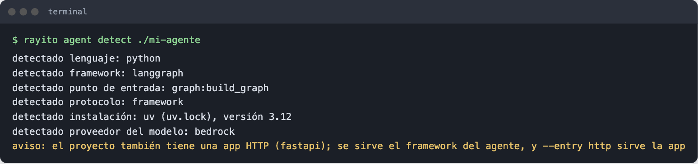
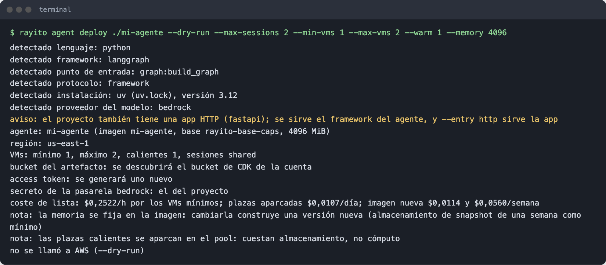

# Your agent in 5 minutes { #tu-agente-en-5-minutos }

You have an agent that already works on your laptop and you want it running in
your AWS account, isolated in a MicroVM and with its model credential out of its
reach. This page does it with one command and no changes to its code. The
details of each step are in [Deploy your agent](../guias/despliega-tu-agente.md).

## What you need { #que-necesitas }

- [Rayito set up in your account](configurar-aws.md), with the
  `rayito-base-caps` image published.
- A Bedrock API key in the `AWS_BEARER_TOKEN_BEDROCK` variable (or your
  provider's: `ANTHROPIC_API_KEY`, `OPENAI_API_KEY`…).
- An agent project with its lockfile (`uv.lock`, `requirements.txt` or
  `package-lock.json`) and the model id in the code. A LangGraph graph, a Strands
  agent, a deepagents agent, a Vercel AI SDK agent, a Hermes agent or an HTTP app
  will do.

## 1. See what it detects { #1-mira-que-detecta }

```bash
rayito agent detect ./mi-agente
```



It reads the project files; it does not run your code or call AWS. If something
is not what you expected, change it with `--framework`, `--entry` or by writing
the key in a `rayito-agent.toml` (`--write` saves it for you to edit).

## 2. See the plan and the cost { #2-mira-el-plan-y-el-coste }

```bash
rayito agent deploy ./mi-agente --dry-run --max-sessions 2 --min-vms 1 --max-vms 2 --warm 1 --memory 4096
```



It creates nothing. It tells you which bucket, secret and base image it would
use, how many VMs you would have and how much each costs per hour.

## 3. Deploy it { #3-despliegalo }

```bash
export AWS_BEARER_TOKEN_BEDROCK=...        # your key; it is stored in Secrets Manager and not written to disk
rayito agent deploy ./mi-agente --create-secret
```

The first time it builds the agent image (a few minutes: it installs the
runtime and your dependencies with their pinned versions); later times reuse it
if nothing changed. When done it prints the fleet name and leaves the access
token in `.rayito/agent-token` (mode `0600`; do not commit it).

## 4. Call it { #4-llamalo }

=== "CLI"

    ```bash
    rayito agent invoke mi-agente "What is 17 plus 25?"
    ```

=== "Python"

    ```python
    from pathlib import Path

    from rayito import AgentFleet

    fleet = AgentFleet.connect(
        "mi-agente", access_token=Path(".rayito/agent-token").read_text().strip()
    )
    reply = fleet.invoke("What is 17 plus 25?")
    print(reply.text)
    ```

=== "TypeScript"

    ```ts
    import { readFileSync } from "node:fs";
    import { AgentFleet } from "rayito";

    const fleet = await AgentFleet.connect("mi-agente", {
      accessToken: readFileSync(".rayito/agent-token", "utf8").trim(),
    });
    const reply = await fleet.invoke("What is 17 plus 25?");
    console.log(reply.text);
    ```

## 5. Stop it { #5-paralo }

```bash
rayito agent stop mi-agente
```

It terminates every VM of the fleet. If you do not stop it, it lives at most 8
hours and bills while it runs; with `--idle 300` it suspends itself when nobody
uses it and bills no compute.

## Next { #siguiente }

- [Several sessions and several VMs](../guias/flota-de-agentes.md): more than
  one conversation at a time, queue, warm slots and what happens if the app dies.
- [Deploy your agent](../guias/despliega-tu-agente.md): the project file, the
  frameworks and how the credential reaches the model.
- [Deploy to AgentCore](../guias/desplegar-en-agentcore.md): the same project
  on Amazon Bedrock AgentCore Runtime with `--target agentcore`, without local
  Docker (the image is built in CodeBuild).
- [Deploy with CDK](../guias/desplegar-con-cdk.md): the agent as a
  `RayitoAgent` construct in your CDK app, deployed with `cdk deploy`.
